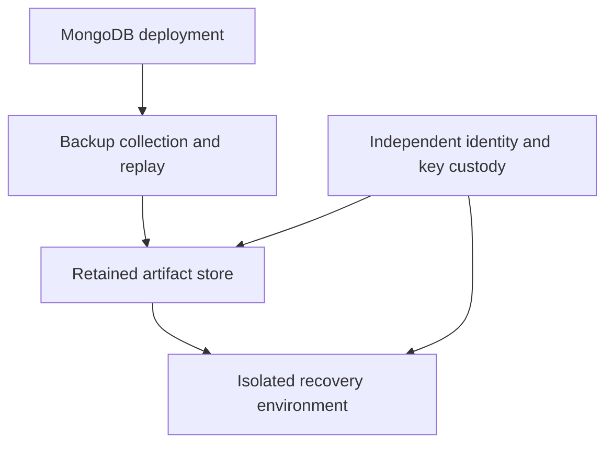

# 49 — Backup Architecture RPO and RTO

Part 7 — Backup Recovery and Disaster Recovery

**Baseline:** MongoDB 8.0; separately versioned Database Tools and backup platform.  
**Status:** Written; static review complete; live backup and restore validation pending.  
**Prerequisites:** Chapters 26–40 for replication/sharding and Chapters 41–48 for credentials, TLS, encryption and key custody.

## 1. Define what must be recovered

A backup architecture is a recoverable set of data, metadata, keys, configuration and procedures. A successful backup job alone does not establish that an application can recover.

This chapter builds a recovery contract, compares architectures, inventories dependencies and evaluates a recovery timeline with a small offline tool. The supplied timeline is synthetic. Running it proves the calculator works, not that MongoDB was backed up or restored. Chapters 50–56 perform the corresponding logical, physical, managed and disaster-recovery exercises.

Do not interrupt the retained Chapter 35 sharded cluster or modify the Chapter 41 TLS standalone for this planning exercise. Replicas and backups solve different problems: a replica can replicate an accidental deletion, while a retained recovery point can preserve the earlier state.

## 2. Set business recovery objectives

| Term | Contract | Evidence |
|---|---|---|
| RPO | Maximum acceptable age of the recovered valid state relative to the incident reference time | Verified recovery cutoff and application acknowledgment records |
| RTO | Maximum elapsed time from an explicitly chosen incident start to validated service restoration | Start/end timestamps and application acceptance |
| Retention | How far back usable recovery points must remain available | Catalog plus tested retrieval and decryption |
| Recovery scope | Which tenants, namespaces and dependent systems must agree | Dataset contract and cross-system reconciliation |

Choose the RTO start explicitly: failure occurrence, detection or incident declaration. Do not change it after the exercise to improve the result. Record detection delay separately if declaration is the chosen start. Here, RTO starts at incident declaration and ends after application validation and approved cutover.

Example teaching objectives are **RPO ≤ 300 seconds**, **RTO ≤ 3,600 seconds**, seven days of point-in-time history where supported, and thirty days of selected retained snapshots. These are exercise inputs, not MongoDB guarantees or universal production requirements. Finance, orders, telemetry and disposable caches can require different contracts.

## 3. Measure RPO without confusing it with a schedule

For a recovery point that represents a consistent state through time `C`, and incident reference time `I`:

`recovery_point_age_seconds = I - C`

Use this conservative age when the cutoff is known and verified. An hourly job can miss its schedule, take time to transfer, or produce an unusable backup. Its recoverable age can exceed an hour. Conversely, a snapshot plus a complete supported replay chain can recover later than the base snapshot.

Also reconcile acknowledged application operations. Record stable operation IDs, acknowledgment times, write concern, transaction boundaries and expected effects outside the failed system. Verify which are present after restore. A heartbeat is only a temporal witness; it does not prove that every business operation or transaction is present. Do not equate an idle collection's latest document time with the platform's latest recoverable cutoff.

For a logical corruption incident, select a clean point before the bad operation. Report the intentionally excluded interval and reconcile legitimate writes from it. Choosing an earlier clean point can make the recovery-point age larger without meaning that all later operations were physically unavailable.

Zero RPO is a claim about the acknowledged operation set under a specified failure model. A short backup interval or majority write concern alone does not establish zero-loss recovery after losing the entire deployment and its backup fault domain.

## 4. Measure the entire RTO

RTO includes incident coordination, provisioning, artifact retrieval, key access, restore/replay, index work where required, consistency checks, application validation and cutover. A process accepting connections is an intermediate milestone.

| Milestone | Required observation |
|---|---|
| Incident declared | Named owner and fixed UTC reference |
| Recovery target ready | Correct version, capacity, network and isolation |
| Artifacts/keys accessible | Approved identity can retrieve and decrypt |
| Database restored | Restore completed without unresolved errors |
| Data validated | Required objects, constraints and operations reconciled |
| Service restored | Application contract passes and cutover approved |

Measure wall-clock elapsed time from start to finish. Stage durations help diagnose delays, but summing overlapping downloads and provisioning double-counts time. Keep critical-path evidence. Report distributions across repeated drills and the slowest relevant scenario; one favorable run is not a reliable percentile.

## 5. Choose an architecture for the topology

| Architecture | Useful role | Design checks before acceptance |
|---|---|---|
| Logical dump/restore | Portable object-level recovery and modest scoped datasets | Concurrent-write consistency, tool compatibility, object coverage and index rebuild time |
| Supported physical snapshot/hot backup | File-level recovery for larger datasets | Storage-engine consistency, volume coverage, version compatibility and encryption dependencies |
| Ops Manager backup | Managed snapshots and supported point-in-time recovery | Supported deployment/FCV, agent health, snapshot/oplog stores, replay continuity and restore target |
| Atlas backup | Managed recovery for an Atlas deployment | Actual tier/features, policy, recovery window and tested regional/account recovery |
| Independent retained copy | Survival of primary storage/account compromise | Independent authorization, retention protection, key custody and tested retrieval |

These options can complement each other. Logical exports can support selective recovery while a managed platform provides whole-deployment recovery. Avoid translating relative vendor comparisons into an unmeasured numeric SLA.

For running physical snapshots, follow the exact MongoDB/storage procedure for consistent data and journal coverage. Copying arbitrary live WiredTiger files with `cp` or `rsync` is not that procedure. For sharded backups, use the documented coordinated workflow for the exact release; unrelated snapshots from different shards and config servers do not automatically form a consistent cluster backup.

## 6. Draw the recovery boundary



Assign separate owners and identities to collection, retention administration and restore approval where the threat model requires it. A different bucket in the same compromised account is not automatically independent. A snapshot with an unavailable KMS key is not a usable recovery point.

Specify which failures the design survives: member loss, storage loss, region loss, credential compromise, malicious deletion, application corruption and key-service outage. Record exclusions. Test recovery when the original deployment is unavailable, rather than quietly depending on its healthy members for missing files or secrets.

## 7. Inventory the complete recovery set

Create a catalog with one record per recovery chain. Do not store passwords, private keys, key material or bearer download URLs in it.

| Catalog field | Example meaning |
|---|---|
| Target and topology | Stable deployment ID; replica set or shard/config-server inventory |
| Exact versions | Server, FCV, tools, backup platform and storage engine |
| Backup identity | Job, snapshot, chain and immutable artifact identifiers |
| Recovery range | Earliest/latest advertised cutoff; independently verified cutoff |
| Integrity | Checksums, sizes, transfer completion and corruption alerts |
| Encryption | Key identifiers/versions, provider and authorized recovery identity |
| Configuration | TLS trust/name requirements, startup options and topology metadata |
| Application dependencies | External services, schema version and reconciliation procedure |
| Retention/isolation | Expiry, fault domain and deletion protection actually configured |
| Restore evidence | Drill ID, selected cutoff, validation result and elapsed time |

For CSFLE/Queryable Encryption, preserve the required key-vault documents and corresponding KMS access along with application configuration. For encrypted storage, preserve the matching key access and follow cipher-specific restore procedures. Chapter 45 explains why cold AES256-GCM restore requires particular key-rollover handling; do not treat encrypted files as self-contained.

## 8. Budget capacity and replay continuity

Separate source impact, backup storage and restore capacity. Include data, indexes, metadata, journals, replay history, temporary files, retained generations and working space. Deduplication/compression ratios must come from observed workloads.

For a rough transfer lower bound:

`transfer_seconds >= artifact_bytes / effective_bytes_per_second`

For replay, estimate both the backlog and sustained apply rate. If new captured work arrives faster than it can be processed, the backlog will grow. Validate peak workloads and throttling; average daily change rate hides bursts.

Example: 500 GiB transferred at an effective 100 MiB/s takes at least 5,120 seconds, already exceeding the 3,600-second example RTO before provisioning and validation. This motivates a different recovery path, more bandwidth or a revised objective. It does not establish actual restore speed.

Keep the source oplog window large enough for the backup collector's supported outage and catch-up needs, with measured headroom. A large local oplog does not itself provide retained independent point-in-time backups. Monitor collector gaps and the latest usable replay range, not only oplog size.

## 9. Create the planning workspace

This lab needs Python 3 and no MongoDB connection. It creates only local planning files.

```bash
umask 077
mkdir mongodb-ch49
cd mongodb-ch49
mkdir scripts evidence
export LAB49_ROOT="$PWD"
```

Save the program in Section 11 as `scripts/recovery49.py`. Keep the exercise directory separate from server data and key directories. Use UTC timestamps with explicit offsets. Clock synchronization and timestamp uncertainty belong in the actual recovery evidence; the calculator cannot discover them.

## 10. Define a synthetic recovery timeline

Save this as `evidence/synthetic49.json`:

```json
{
  "format": 1,
  "kind": "synthetic",
  "target": "planning-only-ch49",
  "rpo_limit_seconds": 300,
  "rto_limit_seconds": 3600,
  "incident_at": "2026-10-11T10:00:00Z",
  "recoverable_through": "2026-10-11T09:57:00Z",
  "service_restored_at": "2026-10-11T10:40:00Z",
  "consistent_cutoff_verified": true,
  "application_validation_passed": true,
  "dependencies_available": true
}
```

The three true flags are invented inputs for the arithmetic exercise. They are not observations. The output always labels a synthetic result as `planning_only`. Expected age is 180 seconds and elapsed recovery is 2,400 seconds.

For an actual drill, change `kind` to `drill`, use the real deployment ID/times and attach the source evidence to the review package. Set a flag true only after its corresponding check succeeds. The program still assesses declared inputs; a reviewer must inspect the underlying restore, cutoff and application evidence.

## 11. Implement a strict timeline evaluator

```python
#!/usr/bin/env python3
"""Evaluate declared recovery timestamps; never perform a backup or restore."""
import datetime as dt
import json
import math
import sys

FIELDS = {
    "format", "kind", "target", "rpo_limit_seconds", "rto_limit_seconds",
    "incident_at", "recoverable_through", "service_restored_at",
    "consistent_cutoff_verified", "application_validation_passed",
    "dependencies_available",
}
FLAGS = ("consistent_cutoff_verified", "application_validation_passed",
         "dependencies_available")

def pairs(items):
    result = {}
    for key, value in items:
        if key in result:
            raise ValueError("duplicate JSON field")
        result[key] = value
    return result

def timestamp(value):
    if not isinstance(value, str):
        raise ValueError("timestamp must be a string")
    value = dt.datetime.fromisoformat(value.replace("Z", "+00:00"))
    if value.tzinfo is None or value.utcoffset() is None:
        raise ValueError("timestamp needs an explicit UTC offset")
    return value.astimezone(dt.timezone.utc)

def evaluate(data):
    if not isinstance(data, dict) or set(data) != FIELDS:
        raise ValueError("missing or unknown fields")
    if type(data["format"]) is not int or data["format"] != 1:
        raise ValueError("unsupported format")
    if data["kind"] not in ("synthetic", "drill"):
        raise ValueError("kind must be synthetic or drill")
    if not isinstance(data["target"], str) or not data["target"].strip():
        raise ValueError("target required")
    for key in ("rpo_limit_seconds", "rto_limit_seconds"):
        value = data[key]
        if type(value) not in (int, float) or not math.isfinite(value) or value < 0:
            raise ValueError("limits must be finite nonnegative numbers")
    if any(type(data[key]) is not bool for key in FLAGS):
        raise ValueError("validation flags must be booleans")
    incident = timestamp(data["incident_at"])
    cutoff = timestamp(data["recoverable_through"])
    restored = timestamp(data["service_restored_at"])
    if cutoff > incident or restored < incident:
        raise ValueError("cutoff/incident/restoration order invalid")
    rpo = (incident - cutoff).total_seconds()
    rto = (restored - incident).total_seconds()
    checks = {
        "rpo_within_limit": rpo <= data["rpo_limit_seconds"],
        "rto_within_limit": rto <= data["rto_limit_seconds"],
        **{key: data[key] for key in FLAGS},
    }
    meets = all(checks.values())
    return {
        "target": data["target"], "kind": data["kind"],
        "claim": "planning_only" if data["kind"] == "synthetic"
                 else "declared_drill_inputs_only",
        "recovery_point_age_seconds": rpo, "rto_seconds": rto,
        "checks": checks, "declared_inputs_meet_objectives": meets,
    }

def main():
    if len(sys.argv) != 2:
        print("usage: recovery49.py timeline.json", file=sys.stderr)
        return 1
    try:
        with open(sys.argv[1], encoding="utf-8") as source:
            data = json.load(source, object_pairs_hook=pairs)
        result = evaluate(data)
    except (OSError, ValueError, TypeError, OverflowError) as error:
        print("invalid input: " + str(error), file=sys.stderr)
        return 1
    print(json.dumps(result, indent=2, allow_nan=False))
    return 0 if result["declared_inputs_meet_objectives"] else 2

if __name__ == "__main__":
    sys.exit(main())
```

Exit `0` means the declared inputs meet the limits and all required flags are true. Exit `2` means valid inputs fail at least one requirement. Exit `1` means invalid or unreadable inputs. None of these exit codes proves a live restore occurred.

## 12. Run positive and negative planning cases

```bash
python3 scripts/recovery49.py evidence/synthetic49.json > evidence/synthetic49-result.json
python3 -m json.tool evidence/synthetic49-result.json
```

Inspect `claim: planning_only`, age 180 and RTO 2400. Then create separate files for these cases rather than overwriting the baseline:

| Change | Expected result |
|---|---|
| Cutoff `09:50:00Z` | Age 600; exit 2 |
| Service restored `11:10:00Z` | RTO 4200; exit 2 |
| `dependencies_available: false` | Exit 2 even with favorable times |
| Timestamp without offset | Exit 1 |
| Cutoff after incident | Exit 1 |
| Boolean used as a numeric limit | Exit 1 |
| Duplicate or unknown JSON field | Exit 1 |

Do not hide a failed case using an unconditional success command. Capture its actual exit code and distinguish an expected negative test from an accepted recovery. Boundary values exactly equal to the objectives pass the numeric checks.

## 13. Plan the actual backup and isolated restore

Before Chapter 50 or the selected physical/managed lab, complete this runbook:

1. Identify an owned disposable source and a separately provisioned restore target. Pin exact versions and topology. Record the failure model and recovery objectives.
2. Establish a deterministic application fixture and external acknowledgment journal. Define counts, ordered operation IDs, business totals, indexes, validators and encrypted-field checks where applicable.
3. Execute the selected supported backup workflow. Record actual scope, completion, checksums and recovery cutoff/range; preserve the required replay chain.
4. Confirm restore identities, TLS, key access, artifact retrieval and isolation without relying on credentials stored only on the source.
5. Declare the drill incident time. Restore to the selected point on the isolated target. Never restore over the source as an exploratory step.
6. Validate data and application behavior, including relationships and acknowledged operations. Record exclusions and errors. Do not expose the restored target to ordinary clients before approval.
7. Record the service-restored timestamp at the defined acceptance milestone. Evaluate real inputs and have the owner review the underlying evidence.

If a clean point predates a deletion or corruption event, explicitly identify the event boundary. A checksum verifies bytes match the artifact; it does not prove logical correctness. Include a test of retrieval and decryption when the original infrastructure is unavailable.

## 14. Account for replica sets and sharded clusters

For replica sets, document the backup source selection, supported read/backup behavior, replay continuity and handling of elections. Do not assume any secondary is an independent backup or that copying its files establishes point-in-time recovery.

For sharded clusters, the recoverable set includes shard data and config-server metadata under a coordinated consistency procedure. Record the shard/config replica-set map, collection placement metadata, balancer state and relevant version-specific restrictions. Do not combine independently chosen shard cutoffs into a claimed global point.

Ops Manager's backup mechanics depend on server compatibility and platform version. Its supported backup process uses consistent storage-engine capture and oplog collection; current deployments should not be described using an obsolete universal initial-sync model. Chapter 52 configures the managed workflow and tests its actual restore path.

For logical sharded backups, follow the release-specific documented procedure, including its write/balancer controls. Chapter 50's replica-set dump options are not automatically a whole sharded-cluster backup recipe. Chapter 55 handles sharded recovery explicitly.

## 15. Monitor recoverability and rehearse failure

| Signal | Response |
|---|---|
| Latest usable cutoff older than RPO budget | Investigate ingestion/replay gaps and artifact availability |
| Backup job healthy but restore untested | Schedule isolated verification; keep acceptance pending |
| Replay history gap | Determine which recovery ranges remain valid; repair or rebaseline as supported |
| Missing/disabled key version | Restore authorized access; preserve affected artifacts; assess scope |
| Store saturation or slow retrieval | Expand capacity or change architecture and retest |
| Shared-account deletion risk | Verify independent retention and recovery identity |
| Drill exceeds RTO | Identify critical-path delays and repeat after changes |

Alarm on the recoverability budget, not merely on job completion. Rotate credentials with overlapping recovery access where appropriate, and prove old retained artifacts remain decryptable under the retention policy. A delete-protected backup that no authorized recovery operator can access is still operationally unusable.

Rehearse source loss, unavailable ordinary administrator credentials, unavailable primary region and clean-point selection. Keep production destructive failure injection outside this disposable lab's authorization.

## 16. Acceptance evidence and cleanup

Chapter 49 planning acceptance requires a signed recovery contract, architecture/fault-domain decision, complete dependency catalog, capacity assumptions, synthetic evaluator results and a scheduled actual restore drill. Label this **planning complete; live recovery pending**.

Live recovery acceptance additionally requires real backup/restore logs, verified cutoff, application reconciliation, key-access evidence, elapsed RPO/RTO results and owner signoff. The tutorial's static checks cannot satisfy those conditions.

Archive the chapter's planning files in the protected evidence location. This chapter creates no MongoDB users, databases, backup jobs or server configuration, so there is no database cleanup command. Delete only the explicitly owned local exercise directory if its evidence is no longer needed. Never expire actual backup artifacts or old encryption keys simply to tidy a lab; their retention and dependencies require a reviewed decision.

## 17. References and next chapter

- [MongoDB 8.0 backup methods](https://www.mongodb.com/docs/v8.0/core/backups/)
- [Filesystem snapshot procedures](https://www.mongodb.com/docs/v8.0/tutorial/backup-with-filesystem-snapshots/)
- [Sharded cluster dump procedure](https://www.mongodb.com/docs/v8.0/tutorial/backup-sharded-cluster-with-database-dumps/)
- [Ops Manager backup process](https://www.mongodb.com/docs/ops-manager/current/core/backup-overview/)
- [Ops Manager backup preparations](https://www.mongodb.com/docs/ops-manager/current/core/backup-preparations/)
- [Previous: Chapter 48 — Security Hardening Acceptance Lab](48-security-hardening-acceptance-lab.md)

Use the documentation matching the installed release, FCV, tool version and backup platform. Managed-service capabilities and retention policies must be verified on the actual deployment.

Next: **Chapter 50 — mongodump mongorestore and Logical Recovery** (planned).
