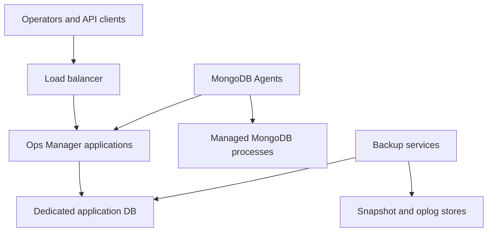

# 57 — Ops Manager Architecture and Prerequisites

Part 8 — Administration Deployment and Integration

**Baseline:** Managed MongoDB 8.0/FCV 8.0; an explicitly selected, supported Ops Manager release and compatible MongoDB Agent. Linux host assessment with Python 3 and OpenSSL.  
**Status:** Written; static review complete; live Ops Manager prerequisite assessment pending.  
**Prerequisites:** Chapters 25–32, 41–48 and 49–56; authorized lab hosts, release documentation and access to the intended internal endpoints.

## 1. Define what Ops Manager manages

Ops Manager is the self-hosted management system for MongoDB deployments. Its application exposes the user interface and agent services; a dedicated backing replica set holds management data. Optional backup facilities need their own storage design. The managed application databases remain separate from the management system's backing databases.

This chapter produces an architecture and prerequisite packet before installation or agent enrollment. Its runnable lab performs local host observations and bounded DNS/TLS connectivity checks. It does not install software, register agents, import deployments, enable automation or configure backup jobs. Chapter 58 continues with automation, monitoring and agents.

Success means the proposed design has named owners, a reviewed compatibility matrix, explicit network and storage boundaries, and evidence for the checks performed. An HTTP page, an open TCP port or a successful TLS handshake alone does not establish Ops Manager readiness.

## 2. Map components and dependencies



The diagram shows conceptual dependency boundaries, not an exhaustive firewall specification. Backup traffic paths vary with release, FCV, store type and restore mechanism. Derive actual directed flows from the selected release documentation before opening network access.

| Component | Operational responsibility | Separate protection required |
|---|---|---|
| Ops Manager application | UI/API and agent-facing management services | Configuration, application availability, TLS and access |
| Application Database | Management metadata and collected operational information | Dedicated replica set, tested backing-database recovery |
| MongoDB Agent | Selected monitoring, automation and backup functions on managed hosts | Enrollment credentials, executable access, local privileges |
| Managed MongoDB | Business workload and replicated data | Its own security, capacity and recovery contract |
| Backup services/stores | Snapshot processing, retained backup content and replay history | Retention, repository availability, keys and restore validation |

Keep management metadata and backup content within the same recovery design. Recovering only snapshot bytes without the required metadata, access or keys can leave the restore path unusable. Do not put business collections in the dedicated Application Database.

## 3. Separate monitoring, automation and backup authority

Monitoring collects observations; automation reconciles approved process configuration; backup captures recoverable history according to the enabled mechanism. These functions have different permissions and failure consequences. A deployment visible in monitoring is not necessarily managed by automation or protected by a valid backup.

An automation import can transfer configuration authority to the management system. Review existing service managers, configuration management, operators and deployment pipelines before enrollment. Competing owners can repeatedly change configuration or restart processes.

| Proposed action | Evidence required before execution |
|---|---|
| Monitoring enrollment | Approved endpoint and identity scope; collection overhead understood |
| Automation import | Supported topology/version, configuration diff, ownership transition and maintenance plan |
| Backup enablement | Supported deployment/FCV, available stores, access, retention and recovery objectives |
| Restore | Verified point, target identity, overwrite boundaries, isolation and acceptance |

This chapter authorizes none of those external changes. Its assessment is the concrete input to the subsequent implementation plan.

## 4. Freeze the release compatibility matrix

MongoDB Server version, FCV, Ops Manager version and MongoDB Agent version are independent values. The backing databases have their own supported server-version rules. Do not infer that an Ops Manager release requires, supports or ships a matching-number MongoDB release simply because both names contain `8.0`.

The `current` documentation moves with the product. Use the documentation selector for your selected release and retain the exact URL, review date and requirements. This series keeps managed MongoDB at 8.0/FCV 8.0 unless a later chapter explicitly changes that baseline; this chapter does not initiate an upgrade.

| Item | Record exact value | Validate against |
|---|---|---|
| Ops Manager | Release and patch, package hash, support entitlement | Release notes, lifecycle and installation requirements |
| Managed MongoDB | Version, FCV, edition, topology | Management and backup compatibility matrix |
| Application Database | Version, FCV, authentication and topology | Backing-database requirements |
| Backup stores | Store type, backing MongoDB versions, storage endpoint | Store-specific support and configuration requirements |
| Agent | Version, host OS/CPU architecture | Selected Ops Manager supported agent/platform combination |
| Runtime/package | Bundled or required runtime, repository source | Exact installation package instructions |
| Kubernetes route, if used | Operator/controller and CRD versions | Operator/Ops Manager/server compatibility |

Do not write an unconditional Java installation command or hard-coded backing MongoDB version into the build plan until the selected package's requirements are known. Likewise, evaluate actual server binaries and FCV separately for backup behavior.

## 5. Choose the installation and availability model

Choose a supported package-based VM/bare-metal installation or the supported Kubernetes controller route. The remaining lab commands assume a Linux host assessment, not a Kubernetes installation. On Kubernetes, assess pod requests/limits, PV behavior, topology spreading, service discovery, disruption policy and controller compatibility in addition to node capacity.

| Design | Appropriate use | Failure boundary to document |
|---|---|---|
| Single-host evaluation | Disposable product exploration | Host loss can remove the application, metadata and local backups together |
| Redundant backing stores, one application instance | Limited management-service availability requirement | Application host failure can still interrupt UI/API availability |
| Multiple application instances and redundant backing stores | Management-service availability design | Load balancer, shared configuration and database/storage dependencies remain |
| Separate backup/recovery failure domain | Recovery after management or workload infrastructure loss | Repository access, metadata and keys must survive the same incident |

For production backing replica sets, plan at least three data-bearing members with appropriate failure-domain separation. An arbiter contributes no copy of management or backup data. Multiple application instances require consistent configuration and shared backing data; application redundancy does not by itself provide backup daemon failover or repository durability.

A load balancer must preserve the application's supported semantics and avoid caching management responses. Review TLS termination/re-encryption, timeouts, health checks, forwarded information and agent routing against the exact release guidance. Count load balancer and DNS failure modes in the design.

## 6. Design backing storage and backup dependencies

Inventory application metadata storage, snapshot storage, oplog storage, temporary working space and logs separately. A snapshot store may use supported database, filesystem or S3-compatible storage; that choice does not eliminate the need to plan retained replay history and associated metadata.

Do not apply a single data-size multiplier as a guaranteed capacity requirement. Snapshot cadence, changed blocks, compressibility, retention, concurrent restores, maintenance/grooming, oplog volume and replication multiply different parts of the footprint. Measure the actual workload and review the vendor's component-specific sizing guidance.

| Storage area | Capacity inputs | Performance and failure tests |
|---|---|---|
| Application DB | Hosts/projects, metrics retention, metadata growth | Replica-set latency, storage saturation and member replacement |
| Snapshot store | Dataset, change rate, retention, compression/deduplication behavior | Capture throughput, maintenance reserve and restore throughput |
| Oplog store | Oplog generation rate and required replay window | Ingestion lag, continuity, retention and replay access |
| Work/temporary space | Selected backup mechanism and concurrent jobs | Exhaustion handling and sustained I/O |
| Logs | Rotation, retention, peak error volume | Disk-full prevention and safe collection |

For S3-compatible storage, validate the supported endpoint implementation, authentication method, TLS trust, bucket policy and object lifecycle behavior. Do not enable object expiry, immutability or access changes without confirming compatibility with backup maintenance and retention. A generic S3 API response is insufficient proof of a supported snapshot store.

Protect the Application Database independently and test its recovery with matching Ops Manager configuration and keys. Avoid relying exclusively on the same failed management installation to recover its own backing data.

## 7. Build a directed network matrix

Use configured ports rather than copying example defaults into firewalls. Ops Manager's default web listener is commonly 8080, but production TLS endpoints and health listeners can be different. MongoDB and object-store ports are also configurable. Record the actual endpoint, listener and TLS termination location for each path.

| Initiator | Destination | Purpose | Required evidence |
|---|---|---|---|
| Operator/API client | Management entry point | UI/API | DNS, trusted TLS, approved authentication path |
| Agent host | Management endpoint | Configuration/telemetry/service interactions | Host-specific connectivity and CA trust |
| Application host | Every relevant backing DB member | Metadata operations | DNS, member TLS/authentication and replica discovery |
| Agent host | Managed MongoDB processes | Selected agent functions | Intended privileges and local/remote listener access |
| Backup/restore participant | Configured stores and applicable database endpoints | Capture, replay and restore | Release-specific directed flow tests |
| Eligible downloader | Approved binary source or local repository | Installation/runtime artifacts | Package availability, checksum and proxy trust |
| Components | DNS/time/identity/KMS/email as applicable | Supporting dependencies | Access under normal and recovery conditions |

A successful probe from your workstation does not prove access from an agent pod or backup host. Run the relevant probes from each actual initiator. Load balancer reachability does not prove direct application-node or backing-member reachability.

For restricted Internet environments, plan supported local binary distribution before onboarding. Retain required server/agent packages and release-specific manifests under controlled access. Local mode, proxy settings and client download paths must match the chosen release; do not grant broad outbound Internet as a substitute for a reviewed distribution design.

## 8. Establish identities, TLS and bootstrap access

Separate Ops Manager UI/API identities, agent enrollment credentials, backing database users, managed database users and storage/KMS credentials. Store secrets in an approved secret system and document renewal owners. Keep public trust material and private keys distinct in the evidence packet.

Certificates need correct endpoint names, trust chains and validity. Consider client-certificate requirements separately from server certificate verification. A reverse proxy certificate can pass while the application-to-database trust chain fails. Test from the service's actual runtime context, including filesystem permissions and trust-store format.

Create a reviewed bootstrap procedure for the first administrator and backing-database access. Record how an authorized operator can recover management access when the normal identity provider is unavailable. Do not embed passwords in shell history, process arguments, architecture JSON or screenshots.

Automation credentials can affect process configuration and availability. Apply project boundaries and least privilege, restrict API access, and review enrollment secrets before placing an agent on a host. No API or agent secrets are required by the read-only probe below.

## 9. Prepare the hands-on assessment workspace

Use an authorized Linux host or an isolated host with the same network placement as a planned Ops Manager component. Install no packages through this chapter. If Python/OpenSSL or OS inspection tools are unavailable, record the missing prerequisite and use an approved equivalent.

```bash
umask 077
mkdir mongodb-ch57
cd mongodb-ch57
export LAB57_ROOT="$PWD"
mkdir input scripts evidence
python3 --version
openssl version
date -u +'%Y-%m-%dT%H:%M:%SZ' > evidence/assessment-start57.txt
uname -srm > evidence/kernel57.txt
cat /etc/os-release > evidence/os57.txt
id > evidence/operator57.txt
getconf _NPROCESSORS_ONLN > evidence/cpu57.txt
cat /proc/meminfo > evidence/memory57.txt
df -Pk > evidence/filesystems57.txt
ulimit -Sn > evidence/nofile-soft57.txt
ulimit -Hn > evidence/nofile-hard57.txt
ulimit -Su > evidence/nproc-soft57.txt
ulimit -Hu > evidence/nproc-hard57.txt
```

These are observations of the current shell/host. Shell limits do not prove a systemd service's effective limits. Host memory does not prove container/pod allocation. Supplement with reviewed service-manager settings or pod specifications before accepting runtime capacity.

Collect mount identity, capacity, inode availability, owner/group, persistence and storage class for each intended data/log/temp location. Inspect existing paths only; do not run arbitrary write benchmarks against production storage or create/change permissions on shared directories. Clock synchronization needs its own observation from the platform's actual time service.

## 10. Define bounded endpoint probes

Save `input/endpoints57.json`. Replace the examples with endpoints that you are authorized to contact and a PEM CA bundle path readable on this host. The script refuses example names. List every backing member relevant to this initiator, not only the current primary.

```json
{
  "schema": 1,
  "assessmentId": "REPLACE_WITH_ASSESSMENT_ID",
  "initiator": "REPLACE_WITH_HOST_OR_POD_ID",
  "endpoints": [
    {"id": "management-entry", "host": "ops57.example.invalid", "port": 8443,
     "caFile": "/approved/pki/ca.pem"},
    {"id": "application-db-a", "host": "appdb57a.example.invalid", "port": 27017,
     "caFile": "/approved/pki/ca.pem"},
    {"id": "application-db-b", "host": "appdb57b.example.invalid", "port": 27017,
     "caFile": "/approved/pki/ca.pem"},
    {"id": "application-db-c", "host": "appdb57c.example.invalid", "port": 27017,
     "caFile": "/approved/pki/ca.pem"}
  ]
}
```

This TLS-only probe does not send MongoDB commands or HTTP requests. The listed service must accept a standard TLS handshake without a required client certificate. If the actual service requires mutual TLS, record that prerequisite and use an approved client-certificate adapter. Do not weaken that service to make this probe succeed.

The TLS context validates the supplied trust bundle and host name. It does not perform a full revocation-policy assessment or establish MongoDB authentication, API authorization, replication health or management-service health.

## 11. Implement the DNS and TLS observer

Save `scripts/probe57.py`. At most 30 explicitly listed endpoints are allowed. Each connection has a five-second socket timeout; operating-system DNS lookup time is platform dependent. Run under your platform's job deadline when bounded total runtime is required. No discovery scan or secret collection is performed.

```python
import datetime as dt
import hashlib
import json
import pathlib
import socket
import ssl
import sys
import time

def require(ok, message):
    if not ok:
        raise ValueError(message)

def load_plan(path):
    raw = pathlib.Path(path).read_bytes()
    plan = json.loads(raw)
    require(isinstance(plan, dict) and set(plan) ==
            {'schema', 'assessmentId', 'initiator', 'endpoints'}, 'invalid plan fields')
    require(type(plan['schema']) is int and plan['schema'] == 1, 'unsupported schema')
    for key in ('assessmentId', 'initiator'):
        require(isinstance(plan[key], str) and plan[key].strip() and
                'REPLACE' not in plan[key], 'real assessment identity required')
    endpoints = plan['endpoints']
    require(isinstance(endpoints, list) and 1 <= len(endpoints) <= 30,
            'one to thirty endpoints required')
    ids = set()
    for endpoint in endpoints:
        require(isinstance(endpoint, dict) and set(endpoint) ==
                {'id', 'host', 'port', 'caFile'}, 'invalid endpoint fields')
        identity, host = endpoint['id'], endpoint['host']
        require(isinstance(identity, str) and identity.strip() and identity not in ids,
                'unique endpoint IDs required')
        ids.add(identity)
        require(isinstance(host, str) and host and host == host.strip() and
                not any(c in host for c in '/:@') and not host.endswith('.invalid'),
                'real DNS host or IPv4 address required')
        require(type(endpoint['port']) is int and 1 <= endpoint['port'] <= 65535,
                'invalid port')
        require(isinstance(endpoint['caFile'], str) and
                pathlib.Path(endpoint['caFile']).is_absolute() and
                pathlib.Path(endpoint['caFile']).is_file(), 'absolute existing CA bundle required')
    return plan, hashlib.sha256(raw).hexdigest()

def observe(endpoint):
    start = time.monotonic()
    row = {'id': endpoint['id'], 'host': endpoint['host'], 'port': endpoint['port'],
           'dnsResolved': False, 'tlsVerified': False}
    try:
        addresses = socket.getaddrinfo(endpoint['host'], endpoint['port'],
                                      type=socket.SOCK_STREAM)
        row['resolvedAddresses'] = sorted({a[4][0] for a in addresses})
        row['dnsResolved'] = bool(addresses)
        context = ssl.create_default_context(cafile=endpoint['caFile'])
        with socket.create_connection((endpoint['host'], endpoint['port']), timeout=5) as raw:
            with context.wrap_socket(raw, server_hostname=endpoint['host']) as secure:
                row.update(tlsVerified=True, tlsVersion=secure.version(),
                           peerCertificateSha256=hashlib.sha256(
                               secure.getpeercert(binary_form=True)).hexdigest(),
                           peerAddress=secure.getpeername()[0])
    except (OSError, ssl.SSLError, ValueError) as error:
        row['errorType'] = type(error).__name__
        # Detailed errors can contain internal infrastructure information.
        row['error'] = str(error)
    row['elapsedSeconds'] = round(time.monotonic() - start, 3)
    return row

def run(plan_path, output_path):
    plan, digest = load_plan(plan_path)
    require(not pathlib.Path(output_path).exists(), 'output already exists')
    rows = [observe(endpoint) for endpoint in plan['endpoints']]
    report = {'schema': 1, 'claim': 'dns_and_server_tls_observations_only',
              'assessmentId': plan['assessmentId'], 'initiator': plan['initiator'],
              'observedAt': dt.datetime.now(dt.timezone.utc).isoformat(),
              'planSha256': digest, 'endpoints': rows,
              'allListedTlsPassed': all(row['tlsVerified'] is True for row in rows)}
    with open(output_path, 'x', encoding='utf-8') as out:
        json.dump(report, out, indent=2, sort_keys=True)
        out.write('\n')
    return 0 if report['allListedTlsPassed'] else 2

if __name__ == '__main__':
    try:
        require(len(sys.argv) == 3, 'usage: probe57.py PLAN_JSON NEW_REPORT_JSON')
        sys.exit(run(sys.argv[1], sys.argv[2]))
    except (ValueError, TypeError, KeyError, OSError) as error:
        print('REJECTED: ' + str(error), file=sys.stderr)
        sys.exit(1)
```

Exit 0 means all listed TLS handshakes passed. Exit 2 means a well-formed assessment ran but at least one endpoint failed; the report is retained. Exit 1 indicates invalid inputs or report-writing failure. Private network names and addresses are sensitive operational evidence; retain the report under the appropriate access policy.

## 12. Execute probes and verify failures honestly

From each actual initiator, use that initiator's endpoint plan and a new output filename:

```bash
python3 scripts/probe57.py input/endpoints57.json evidence/connectivity57.json
probe_status57=$?
printf '%s\n' "$probe_status57" > evidence/probe-exit57.txt
sha256sum input/endpoints57.json scripts/probe57.py evidence/connectivity57.json \
  > evidence/probe57.sha256
```

Run this block without a shell setting that skips status collection on nonzero exit, or use an equivalent reviewed wrapper. If input validation failed, a report might not exist: retain stderr and correct the plan before hashing. An unsuccessful endpoint stays failed until a new observed result resolves it; do not edit report flags.

Test the helper with a temporary local TLS server on an owned loopback port and a temporary CA. Require trusted matching-name success, wrong CA rejection, wrong name rejection, closed-port failure and malformed-plan rejection. Test duplicate IDs, boolean/string ports, missing CA files, placeholder hosts and an existing output file. These local tests prove observer behavior only, not the intended infrastructure.

For a real backing replica set, follow the successful TLS observation with an approved authenticated read-only `hello`/replica discovery check using the intended service identity. Review every advertised member name for reachability and certificate coverage. Use an interactive secret prompt or approved protected client configuration; never put credentials in the endpoint JSON.

## 13. Perform the manual prerequisite review

The helper deliberately does not declare installation readiness. Complete the following assessment with real observations and release-specific documentation, recording pass/fail/not-applicable with a reason and owner. A missing check is pending, not passed.

| Gate | What to inspect | Acceptance evidence |
|---|---|---|
| Support and packages | Entitlement, exact versions, patch status and checksums | Reviewed matrix and accessible approved packages |
| Host platform | OS/architecture/runtime, service limits, process owner | Supported environment and effective runtime settings |
| Capacity | Per-component CPU/RAM/disk/tmp/log reserve | Measured allocation and reviewed workload sizing |
| Backing databases | Dedicated data-bearing replica sets, supported versions and authentication | Healthy authenticated discovery and recovery plan |
| Network | Actual directed paths from actual initiators | Connectivity results plus required service-level checks |
| TLS/identity | Service trust stores, hostname coverage, secrets/rotation | Intended identities work with verification enabled |
| Binary distribution | Internet/proxy/local repository path | All required approved artifacts retrievable |
| Backup, if enabled | Stores, replay history, keys, retention and restore access | Supported complete design and scheduled restore drill |
| Availability | Failure domains, application routing and dependencies | Failure scenario review and proposed failover test |
| Ownership | Existing config controllers and automation scope | One named configuration authority per deployment |

File-space and free-memory snapshots alone are insufficient sizing evidence. Inspect actual allocations and the other workloads sharing the host. Do not use the managed server's RAM requirement as the Ops Manager application's heap setting or vice versa.

## 14. Troubleshoot prerequisite failures

| Symptom | Likely boundary | Next read-only check |
|---|---|---|
| DNS succeeds, TLS times out | Listener, routing, firewall, proxy | Confirm configured destination and initiator-specific route |
| Certificate verification fails | CA chain, endpoint SAN, validity or time | Inspect public certificate chain and host clock |
| Workstation passes, agent host fails | Different trust/network context | Repeat from actual service namespace/host |
| TLS succeeds, MongoDB authentication fails | Mechanism, auth DB, user scope, client identity | Review intended identity and supported connection configuration |
| Primary reachable, discovered members fail | Advertised DNS/ports/SAN or firewall | Resolve and probe each advertised member |
| UI accessible, backing DB unavailable | Management dependencies | Inspect backing replica health and application-to-member access |
| Package cannot download | Proxy/local mode, repository or platform mismatch | Verify supported artifacts from the intended downloader |
| Agent and service manager keep restarting processes | Conflicting configuration owners | Identify authority and compare intended configuration without importing |
| Backup sizing appears small while restores fail | Temporary space, throughput, keys or replay gap | Review component capacity and full recovery path |

Do not turn off TLS verification or broaden privileges to obtain a green report. Fix the intended trust/access path and record a new observation. Avoid using generic web login pages as health checks: a proxy can return a page while the management application cannot use its backing database.

## 15. Model availability and management-system recovery

Review loss of an application instance, backing member, snapshot store, object-store access, agent connectivity, identity provider and entire management failure domain. Separate expected workload behavior from management visibility and control: an Ops Manager outage is not automatically a MongoDB data-service outage, but can interrupt management and backup workflows.

| Failure | Design question |
|---|---|
| One application instance unavailable | Can clients/agents reach another correctly configured instance? |
| Backing DB member lost | Does the remaining data-bearing topology preserve required availability? |
| Agent disconnected | What monitoring, reconciliation and backup gaps become visible? |
| Backup store/key unavailable | Can an authorized recovery operator retrieve the required point? |
| Management infrastructure lost | Where are metadata, configuration, packages, identities and backup content recovered? |

Write a management recovery runbook independent of the inaccessible UI. Include configuration and backing-database recovery, supported version alignment, secret access, restore storage access and endpoint restoration. Test a full recovery path under Chapter 56-style acceptance, rather than equating three backing members with a tested disaster recovery plan.

## 16. Acceptance packet and safe cleanup

Deliver a topology map, component/host inventory, version matrix with source links and review date, directed network matrix, capacity calculations, identity/rotation ownership, package distribution plan, host observations, probe results and unresolved prerequisites.

Use the following handoff format:

```text
Assessment ID / date / initiator(s):
Chosen Ops Manager release / managed server version and FCV:
Installation method / backing database topology:
Application and backup availability objectives:
Storage types, capacity reserve and recovery dependencies:
Network and TLS observations / authenticated checks:
Secrets, package distribution and configuration owners:
Failed or pending gates with owner and resolution:
Decision: prerequisite review accepted / blocked / incomplete:
Next implementation scope and maintenance constraints:
```

Acceptance requires all applicable gates to have evidence and an identified reviewer; a successful probe is only one input. Keep the packet outside database paths and omit secrets. The assessment creates only local files and temporary helper-test services. Stop only the exact owned test process after its tests; keep reports and approved public trust material under retention policy. Do not delete existing application data, backing stores or certificates.

This chapter remains runtime pending until the actual authorized host/endpoint assessment and prerequisite review are performed. Offline syntax or local loopback tests do not establish Ops Manager installation readiness.

## 17. References and next chapter

Use the version selector on these official pages for the selected Ops Manager release; retain release-specific links in the assessment packet. `current` is a moving reference.

- [Ops Manager Architecture](https://www.mongodb.com/docs/ops-manager/current/core/system-overview/)
- [Ops Manager System Requirements](https://www.mongodb.com/docs/ops-manager/current/core/requirements/)
- [Ops Manager Installation Checklist](https://www.mongodb.com/docs/ops-manager/current/core/installation-checklist/)
- [Install the Application Database and Backup Database](https://www.mongodb.com/docs/ops-manager/current/tutorial/prepare-backing-mongodb-instances/)
- [Ops Manager Kubernetes resource architecture](https://www.mongodb.com/docs/kubernetes/current/tutorial/arch-om-resources/)
- [Chapter 56 — Restore Drill and Recovery Acceptance Project](56-restore-drill-and-recovery-acceptance-project.md)

Next: **Chapter 58 — Ops Manager Automation Monitoring and Agents** (planned).
