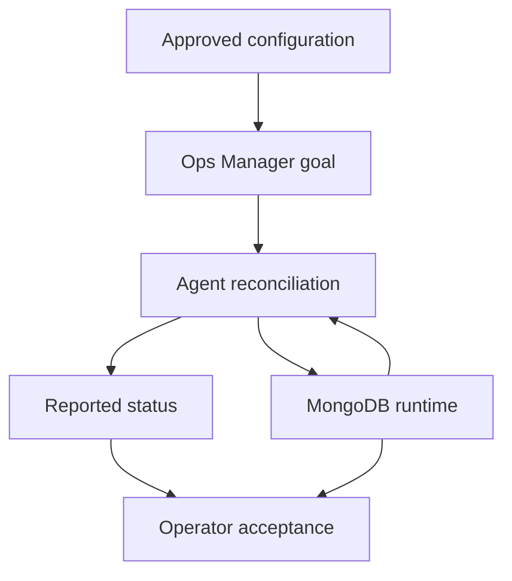

# 58 — Ops Manager Automation Monitoring and Agents

Part 8 — Administration Deployment and Integration

**Baseline:** Managed MongoDB 8.0/FCV 8.0; compatible selected Ops Manager release and MongoDB Agent from Chapter 57. Linux package-based disposable lab.  
**Status:** Written; static review complete; live agent enrollment, monitoring and automation lab pending.  
**Prerequisites:** Chapter 57 prerequisite acceptance, an authorized working Ops Manager installation, three fresh lab hosts, TLS/authentication, Python 3, curl and mongosh.

## 1. Define the operational contract

Enroll agents in a new lab project, provision a disposable three-member replica set, verify monitoring, apply a narrowly reviewed automation change, verify the accepted goal and actual runtime, then restore the original setting. Retain configuration and health evidence throughout.

This lab does not import a retained tutorial deployment or production service. It assumes the management application and backing databases are already installed, healthy and assessed under Chapter 57. No backup job is enabled here; agent availability and automation success do not prove recoverable backups.

The controlled change is one member's `operationProfiling.slowOpThresholdMs` from an explicitly configured 100 to 150 milliseconds, then back to 100. The profiler level remains unchanged. This alters slow-operation classification and can affect diagnostic visibility; use only the disposable workload. Review the deployment plan for restart requirements rather than assuming this setting is always applied without a restart.

## 2. Understand the agent control loop

The MongoDB Agent can perform automation, monitoring and backup functions. Automation reconciles approved configuration; monitoring reports observations. Those functions need different evidence and permissions. A running agent process does not prove any particular function is active or healthy.



Configuration submission, agent reconciliation and application acceptance are separate milestones. Check the accepted goal version, per-process convergence and runtime behavior. A green management plan does not certify replica health, credentials or application correctness.

Do not run multiple independent configuration owners against the same process. Manual service restarts, Ansible edits, Kubernetes controllers and automation imports can compete with Ops Manager. Select one authority and document the handoff before onboarding an existing deployment.

## 3. Separate agent and database identities

| Identity | Used for | Required boundary |
|---|---|---|
| Ops Manager human account | Project setup and reviewed deployment changes | Appropriate project role and named change owner |
| API credential | Read-only configuration/status collection in this chapter | Selected-release read permissions and permitted API source IP |
| Agent enrollment credential | Agent connection to its project | Correct project, secret storage and rotation |
| Agent database identity | Supported monitoring/automation functions | Release-documented privileges and authentication mechanism |
| Application identity | Business read/write probe | Only the lab application database |
| Administrative observation identity | Runtime and topology inspection | Approved direct read-only diagnostic access |

API credentials are not agent enrollment credentials. Neither substitutes for MongoDB authentication. Avoid putting secrets into JSON exports intended for sharing, shell arguments, screenshots or the repository. Automation configuration exports and agent logs can contain sensitive material: store them privately and review before sharing.

For TLS, verify management endpoints and every MongoDB member name advertised by replica discovery. Use the actual runtime's trust configuration. Do not disable authentication or certificate verification to make enrollment pass.

## 4. Create the owned project and host inventory

Use a new project named for this exercise and a new run ID. Confirm it has no managed deployments, pending changes or unrelated agents. A dedicated project makes a complete process-inventory check possible; project-wide status on a shared project cannot be silently filtered to this lab.

```bash
umask 077
mkdir mongodb-ch58
cd mongodb-ch58
export LAB58_ROOT="$PWD"
mkdir input scripts evidence private
export RUN58="$(python3 -c 'import uuid; print(uuid.uuid4())')"
printf '%s\n' "$RUN58" > evidence/run58.txt
date -u +'%Y-%m-%dT%H:%M:%SZ' > evidence/start58.txt
```

Record project ID, installation URL, exact Ops Manager/Agent/server versions, host FQDNs, process names, ports, dbPaths, log paths, service accounts and certificate references. Project IDs are stable identifiers; names alone do not guard against selecting a similarly named project.

Reserve three fresh hosts and empty owned dbPaths. Verify the ports are free and no other service manager owns a MongoDB process on those paths. Do not use the Application Database or backup-store hosts as this disposable managed replica set. Do not start an empty-project agent on a host that still contains unrelated processes under ambiguous ownership.

## 5. Install the project-provided agent package

In the selected lab project, open the agent/server installation workflow and select the actual supported host OS/architecture. Download the package from the approved source and verify its version/hash. Follow the installation instructions generated by that Ops Manager release on each owned host.

Use the project-specific enrollment configuration, management URL and CA trust settings shown for your chosen release. Review any generated commands before execution. Keep private enrollment material in the intended protected configuration file or approved secret mechanism. This chapter intentionally does not paste a fixed package URL, old agent version or secret-bearing universal command.

Record the installed unit name and config/log locations from the actual package. Example observation commands below require the actual unit; do not guess it or restart a similarly named database service.

```bash
test -n "${AGENT58_UNIT:?set the installed agent unit from the package}"
systemctl show "$AGENT58_UNIT" -p Id -p ActiveState -p SubState -p MainPID \
  -p User -p Group -p LimitNOFILE -p LimitNPROC
systemctl is-active "$AGENT58_UNIT"
```

Run on each agent host. Review the installed unit locally for executable/config ownership without dumping secret environment variables into the packet. If the package requires a reviewed service start, perform it on the exact owned unit through the installation procedure. Capture a limited, redacted log excerpt showing project connectivity and errors, not the full secret configuration.

Agent enrollment is complete only when Ops Manager reports the intended host/project identity and recent contact. Record enabled functions. Leave backup disabled. If any other project or host appears, stop the enrollment workflow and resolve identity before provisioning a deployment.

## 6. Provision the disposable automated replica set

Use the project's create-deployment workflow to define `rs58lab` with three data-bearing voting members on the owned hosts. Set MongoDB 8.0 and FCV 8.0 according to the accepted compatibility matrix. Set unique owned dbPaths and log paths, intended TLS/authentication and explicit `operationProfiling.slowOpThresholdMs: 100` on every process. Keep profiling disabled unless another reviewed lab contract requires it.

Choose stable process names, for example `lab58-a`, `lab58-b` and `lab58-c`, and record the exact hostnames returned in configuration and status. These labels are examples; replace them consistently with your actual values.

Before confirming deployment, inspect the entire plan: process inventory, server binaries, authentication changes, paths, port bindings, replica membership and restart/start actions. It must create only the owned lab set. Record the accepted configuration version after deployment and wait for all members to converge.

Then verify directly through MongoDB: correct set name and advertised hosts, one primary/two healthy secondaries, three data-bearing voting members, supported server/FCV and intended TLS/authentication. A deployment marked started but still initial-syncing is not the accepted baseline.

If the UI does not expose the chosen setting on the selected release, use its documented advanced configuration workflow with a reviewed schema adapter. Do not invent a `setParameter` mapping or send a hand-built incomplete automation document.

## 7. Verify monitoring and collect baseline workload evidence

Activate/confirm monitoring through the selected project's server/function workflow. Review and deploy any function changes. Check recent agent contact, monitored process identity and current sample timestamps for each member. Monitoring assignments may be distributed; all eligible monitoring agents need the documented reachability to the deployment, not just their local process.

Use a new application database `mongodb_enterprise_tutorial_ch58`. Save `scripts/fixture58.js` and execute with an approved TLS administrator connection to `rs58lab`. It refuses a preexisting database namespace; after initialization, use the verification mode only.

```javascript
const fs58 = require('fs');
const run58 = fs58.readFileSync('/approved/ch58/run58.txt', 'utf8').trim();
const action58 = process.env.ACTION58;
const admin58 = db.getSiblingDB('admin');
const data58 = db.getSiblingDB('mongodb_enterprise_tutorial_ch58');
function assert58(ok, message) { if (!ok) throw new Error(message); }
const hello58 = admin58.runCommand({hello: 1});
assert58(run58 && hello58.setName === 'rs58lab' && hello58.isWritablePrimary === true,
  'owned primary required');
const base58 = Array.from({length: 50}, (_, n) =>
  ({_id: n + 1, code: `order-${n + 1}`, amountCents: (n + 1) * 10}));
if (action58 === 'initialize') {
  assert58(data58.getCollectionInfos().length === 0, 'database is not empty');
  assert58(data58.createCollection('orders').ok === 1, 'collection creation failed');
  data58.orders.createIndex({code: 1}, {unique: true, name: 'code_unique58'});
  data58.orders.insertMany(base58, {writeConcern: {w: 'majority', j: true, wtimeout: 30000}});
  data58.markers.insertOne({_id: 'owner', runId: run58, chapter: 58},
    {writeConcern: {w: 'majority', j: true, wtimeout: 30000}});
} else assert58(action58 === 'verify', 'initialize or verify required');
const owner58 = data58.markers.findOne({_id: 'owner'});
assert58(owner58 && owner58.runId === run58 && owner58.chapter === 58, 'owner mismatch');
const rows58 = data58.orders.find().sort({_id: 1}).toArray();
assert58(rows58.length === 50, 'wrong count');
for (let n = 0; n < rows58.length; n++) {
  const row58 = rows58[n];
  assert58(row58._id === base58[n]._id && row58.code === base58[n].code &&
    row58.amountCents === base58[n].amountCents && Object.keys(row58).length === 3,
    'order mismatch');
}
assert58(rows58.reduce((sum, row) => sum + row.amountCents, 0) === 12750, 'wrong sum');
assert58(data58.orders.getIndexes().some(index => index.name === 'code_unique58' &&
  index.unique === true && index.key.code === 1 && Object.keys(index.key).length === 1),
  'unique index missing');
const status58 = admin58.runCommand({replSetGetStatus: 1});
assert58(status58.ok === 1 && status58.members.length === 3 &&
  status58.members.every(member => member.health === 1) &&
  status58.members.filter(member => member.state === 1).length === 1 &&
  status58.members.filter(member => member.state === 2).length === 2, 'unhealthy topology');
printjson({runId: run58, count: 50, amountCents: 12750, status: status58});
```

Replace `/approved/ch58/run58.txt` with the actual protected local run-ID path on the client. Set `ACTION58=initialize` for the first execution and `ACTION58=verify` afterward; preserve each output separately. Do not place passwords into the URI. Use `--password` with an interactive prompt and verified CA/certificate options as in Chapter 42.

Perform an approved small read workload and confirm process metrics have timestamps after its start. Aggregate charts can lag and unrelated activity can produce nonzero rates; retain direct client results as well as management samples. No artificial latency or slow-operation count is promised by this tiny fixture.

## 8. Capture configuration and status through read-only APIs

For the documented Ops Manager public API, collect `automationConfig` and `automationStatus` with a read-only credential appropriate to the selected release. The following uses HTTP Digest with curl prompting for the private key. If your selected release uses a different supported authentication mechanism, use its documented protected adapter.

```bash
test -n "${OM58_BASE:?set the verified https origin including port}"
test -n "${PROJECT58_ID:?set the owned project ID}"
test -n "${OM58_PUBLIC_KEY:?set the public API key}"
test -f "${OM58_CA:?set the management CA PEM bundle}"
case "$OM58_BASE" in https://*) ;; *) exit 1 ;; esac
case "$PROJECT58_ID" in *[!a-fA-F0-9]*|'') exit 1 ;; esac
test "${#PROJECT58_ID}" -eq 24 || exit 1
test ! -e private/before58.json || exit 1
curl --silent --show-error --fail --digest --user "$OM58_PUBLIC_KEY" \
  --cacert "$OM58_CA" --connect-timeout 10 --max-time 60 \
  --header 'Accept: application/json' \
  "$OM58_BASE/api/public/v1.0/groups/$PROJECT58_ID/automationConfig" \
  --output private/before58.json
```

Require successful curl exit and a valid expected JSON document. HTTP failures or HTML bodies must not become trusted configuration evidence. The protected response may contain secrets. It is never committed or copied unredacted into a public report.

Collect status using the same options and `automationStatus`, saving the API body to a fresh protected file. Record project ID, trusted origin and UTC capture time externally. API response fields do not by themselves bind the result to your local run ID. The wrapper in Section 11 makes the operator's provenance assertion explicit.

## 9. Review exactly one automation change

Select one current healthy secondary and record its exact automation process name. Prepare the UI change from threshold 100 to 150 on that process only. Keep every other field, including server version, FCV, authentication, membership, dbPath, ports and profiler level unchanged.

Before deploying, review all pending changes and ensure no other operator has submitted work. Record the current configuration version and the proposed plan. Do not deploy a plan containing extra updates just because the desired threshold appears somewhere in it.

Save `scripts/review58.py`. This compares full protected before/after configurations, permitting only the known threshold change and a newer top-level version. It reports hashes and field identity without exposing the full configuration. An unexpected metadata or schema change is rejected for manual review rather than automatically ignored.

```python
import copy
import hashlib
import json
import pathlib
import sys

def require(ok, message):
    if not ok:
        raise ValueError(message)

def process_map(config):
    rows = config['processes']
    require(isinstance(rows, list) and len(rows) == 3, 'exactly three lab processes required')
    require(all(isinstance(row, dict) and isinstance(row.get('name'), str) and
                row['name'] for row in rows), 'invalid process records')
    result = {row['name']: row for row in rows}
    require(len(result) == 3, 'duplicate process names')
    return result

def review(before, after, process_name, old, new):
    require(type(old) is int and type(new) is int and (old, new) in ((100, 150), (150, 100)),
            'only the lab forward or reverse change is supported')
    require(isinstance(before, dict) and isinstance(after, dict), 'config objects required')
    require(type(before['version']) is int and type(after['version']) is int and
            after['version'] > before['version'], 'new accepted config version required')
    a, b = copy.deepcopy(before), copy.deepcopy(after)
    amap, bmap = process_map(a), process_map(b)
    require(set(amap) == set(bmap) and process_name in amap, 'process inventory changed')
    old_config = amap[process_name]['args2_6']['operationProfiling']
    new_config = bmap[process_name]['args2_6']['operationProfiling']
    require(type(old_config['slowOpThresholdMs']) is int and
            type(new_config['slowOpThresholdMs']) is int and
            old_config['slowOpThresholdMs'] == old and new_config['slowOpThresholdMs'] == new,
            'threshold mismatch')
    new_config['slowOpThresholdMs'] = old
    a.pop('version'); b.pop('version')
    # Process ordering is not the identity; keep every other array's ordering strict.
    a['processes'] = sorted(amap.values(), key=lambda row: row['name'])
    b['processes'] = sorted(bmap.values(), key=lambda row: row['name'])
    require(a == b, 'additional configuration differences require review')
    return {'claim': 'one_reviewed_threshold_change', 'processName': process_name,
            'beforeVersion': before['version'], 'acceptedVersion': after['version'],
            'oldThresholdMs': old, 'newThresholdMs': new}

if __name__ == '__main__':
    try:
        require(len(sys.argv) == 6, 'usage: review58.py BEFORE AFTER PROCESS OLD NEW')
        paths = [pathlib.Path(path) for path in sys.argv[1:3]]
        blobs = [path.read_bytes() for path in paths]
        result = review(*(json.loads(blob) for blob in blobs), sys.argv[3],
                        int(sys.argv[4]), int(sys.argv[5]))
        result['inputSha256'] = [hashlib.sha256(blob).hexdigest() for blob in blobs]
        print(json.dumps(result, indent=2))
    except (ValueError, TypeError, KeyError, OSError) as error:
        print('REJECTED: ' + str(error), file=sys.stderr)
        sys.exit(1)
```

The before/after comparison is an independent audit after submission, not permission to skip the UI's pre-deployment review. If an exported schema differs from `args2_6.operationProfiling`, stop and implement a release-specific adapter. Do not suppress unrelated changes or reconstruct a truncated API payload.

## 10. Deploy and reconcile actual runtime

Confirm only the reviewed lab plan through Ops Manager. Record the accepted configuration version and deployment time. Collect a fresh configuration export as `private/after58.json`, using the Section 8 command with that new output path.

```bash
test -n "${TARGET58_PROCESS:?set the chosen secondary process name}"
python3 scripts/review58.py private/before58.json private/after58.json \
  "$TARGET58_PROCESS" 100 150 > evidence/change-reviewed58.json
```

If the audit rejects the export, stop acceptance and investigate the actual differences. Do not automatically push the old configuration to undo them: it could overwrite another owner's newer change or revert security settings. Resolve ownership and prepare a new supported corrective plan.

After automation convergence, connect directly to the selected member with an approved TLS diagnostic identity. Check `hello`, its current set/member identity, `db.getProfilingStatus()` on the lab database and `getCmdLineOpts`. The profiling-status `slowms` must be 150, with profiling level `was: 0`. Check the other two members still have 100. Use current topology evidence; a former secondary might have become primary during the exercise.

```javascript
const observationAdmin58 = db.getSiblingDB('admin');
const observationData58 = db.getSiblingDB('mongodb_enterprise_tutorial_ch58');
const observationHello58 = observationAdmin58.runCommand({hello: 1});
if (observationHello58.setName !== 'rs58lab') throw new Error('wrong set');
const profiling58 = observationData58.getProfilingStatus();
if (profiling58.was !== 0 || profiling58.slowms !== 150)
  throw new Error('selected member runtime threshold/profiler differs');
printjson({member: observationHello58.me, profiling: profiling58,
  startupOptions: observationAdmin58.runCommand({getCmdLineOpts: 1})});
```

Use this probe on the selected member only; change the expected value to 100 for the untouched members and the reverse phase. Review startup-option output privately before sharing because it can reveal internal paths and security configuration. The probe reads state and does not call `setProfilingLevel()`.

Run the fixture verification again and inspect replica health and agent/database logs. Compare monitoring sample freshness before and after deployment. A desired value in an exported config is not proof it reached the process.

## 11. Evaluate fresh automation convergence

Build `input/expected58.json` from the owned inventory and the **accepted** goal version. Values below are placeholders. Include the exact process-to-host mapping, a 120-second status freshness limit and the real run/project IDs.

```json
{
  "schema": 1,
  "runId": "REPLACE_WITH_RUN58",
  "projectId": "REPLACE_WITH_PROJECT_ID",
  "goalVersion": 12,
  "maxAgeSeconds": 120,
  "processes": {
    "lab58-a": "lab58a.example.invalid",
    "lab58-b": "lab58b.example.invalid",
    "lab58-c": "lab58c.example.invalid"
  }
}
```

Wrap the latest successful status response with its real capture time and provenance into a new `private/status-envelope58.json`:

```json
{
  "runId": "REPLACE_WITH_RUN58",
  "projectId": "REPLACE_WITH_PROJECT_ID",
  "capturedAt": "REPLACE_WITH_UTC_CAPTURE_TIME",
  "status": {"goalVersion": 12, "processes": []}
}
```

Replace `status` with the complete unmodified response body; the empty example must fail. The provenance fields are the collector's assertion, not server-signed fields. Preserve the API collection logs and trusted origin privately. Do not reuse a previous successful body with a new timestamp.

Save `scripts/convergence58.py`:

```python
import datetime as dt
import hashlib
import json
import pathlib
import re
import sys

def require(ok, message):
    if not ok:
        raise ValueError(message)

def evaluate(expected, envelope, now):
    require(isinstance(expected, dict) and isinstance(envelope, dict), 'objects required')
    require(type(expected['schema']) is int and expected['schema'] == 1, 'wrong schema')
    run = expected['runId']
    require(isinstance(run, str) and run.strip() and 'REPLACE' not in run and
            envelope['runId'] == run, 'run mismatch')
    project = expected['projectId']
    require(isinstance(project, str) and re.fullmatch(r'[a-fA-F0-9]{24}', project) and
            envelope['projectId'] == project, 'project mismatch')
    goal, max_age = expected['goalVersion'], expected['maxAgeSeconds']
    require(type(goal) is int and goal >= 1 and type(max_age) is int and
            1 <= max_age <= 120, 'invalid goal or freshness limit')
    inventory = expected['processes']
    require(isinstance(inventory, dict) and len(inventory) == 3 and
            all(isinstance(name, str) and name.strip() and isinstance(host, str) and
                host.strip() and not host.endswith('.invalid') for name, host in inventory.items()),
            'exact real process inventory required')
    captured = dt.datetime.fromisoformat(envelope['capturedAt'].replace('Z', '+00:00'))
    require(captured.tzinfo is not None and now.tzinfo is not None, 'aware timestamps required')
    age = (now - captured).total_seconds()
    require(0 <= age <= max_age, 'future or stale status')
    status = envelope['status']
    require(isinstance(status, dict) and type(status['goalVersion']) is int and
            status['goalVersion'] == goal, 'unexpected goal; a concurrent change may have won')
    rows = status['processes']
    require(isinstance(rows, list) and len(rows) == 3 and
            all(isinstance(row, dict) and isinstance(row.get('name'), str) for row in rows),
            'exactly three process statuses required')
    require(len({row['name'] for row in rows}) == 3 and
            {row['name'] for row in rows} == set(inventory), 'missing/foreign/duplicate process')
    for row in rows:
        require(row['hostname'] == inventory[row['name']], 'host identity mismatch')
        require(type(row['lastGoalVersionAchieved']) is int and
                row['lastGoalVersionAchieved'] == goal, 'process has not achieved goal')
        require(type(row['errorCode']) is int and row['errorCode'] == 0 and
                row['errorString'] == '', 'reported process error')
        for key in ('errorCodeDescription', 'errorCodeHumanReadable'):
            require(row.get(key, '') == '', 'reported error description')
    return {'claim': 'fresh_recorded_automation_goal_converged', 'runId': run,
            'projectId': project, 'goalVersion': goal, 'statusAgeSeconds': age,
            'processNames': sorted(inventory), 'applicationAcceptanceProven': False}

if __name__ == '__main__':
    try:
        require(len(sys.argv) == 3, 'usage: convergence58.py EXPECTED ENVELOPE')
        blobs = [pathlib.Path(path).read_bytes() for path in sys.argv[1:]]
        report = evaluate(*(json.loads(blob) for blob in blobs),
                          dt.datetime.now(dt.timezone.utc))
        report['inputSha256'] = [hashlib.sha256(blob).hexdigest() for blob in blobs]
        print(json.dumps(report, indent=2))
    except (ValueError, TypeError, KeyError, AttributeError, OSError) as error:
        print('REJECTED: ' + str(error), file=sys.stderr)
        sys.exit(1)
```

Run immediately after collection and require exit 0:

```bash
python3 scripts/convergence58.py input/expected58.json private/status-envelope58.json \
  > evidence/convergence58.json
```

This gate assesses recorded goal/error fields, not heartbeat freshness from individual agents, runtime parameters or application health. Plans can contain historical action names even after convergence, so it does not require an empty `plan`. Missing critical fields fail rather than defaulting to success. If the server advances to another goal, collect and review the actual accepted configuration instead of silently following it.

## 12. Exercise one agent interruption safely

On one approved lab secondary host, identify the exact agent unit and confirm no unrelated process depends on it. Establish a short interruption limit and an independent service restart path. Do not stop `mongod`, alter firewalls or disable monitoring across the entire project.

Use the selected package's supported service commands to stop only that agent briefly and observe its management contact/function state. Before restarting, directly check the replica set and repeat the fixture read. Record which management observations became delayed or unavailable. Agent interruption is not a simulated database failure and does not prove primary election behavior.

Restart the exact agent and verify recent contact, enabled functions and resumed monitoring samples. Collect a new convergence report at the same expected goal if no configuration changed. If another eligible monitor continues collection, record that observed behavior rather than expecting every graph to go blank.

The result must distinguish continued database availability from impaired management visibility/control. Do not submit a new automation change during the interruption. If agent recovery fails, stop further experiments and troubleshoot the explicit dependency.

## 13. Restore the original setting through automation

After all forward checks pass, prepare the supported reverse change on the same process: 150 back to 100. Review the new deployment plan against the current accepted state, including any changes that occurred since the first deployment. Submit a new configuration version; do not restore an old exported document wholesale.

Collect fresh protected configuration as `private/restored58.json`. Run the diff audit with the forward export as the baseline:

```bash
python3 scripts/review58.py private/after58.json private/restored58.json \
  "$TARGET58_PROCESS" 150 100 > evidence/reverse-reviewed58.json
```

Update expected goal version to the reverse plan's accepted version, collect new status/provenance into fresh files and re-run convergence. Directly confirm all three runtime thresholds are 100, profiler configuration remains expected and the fixture/topology/application probes still pass.

A new desired-state configuration is a corrective operation, not a database-data rollback. Never use configuration rollback as a way to recover deleted records or unavailable storage; Chapters 49–56 cover recovery mechanisms.

## 14. Troubleshoot agent and monitoring failures

| Symptom | Check first | Corrective boundary |
|---|---|---|
| Agent not visible | Project credential, URL, CA trust, proxy and recent service logs | Enrollment/access; do not import a deployment to fix connectivity |
| Agent visible but no metrics | Monitoring activation, assignment, MongoDB credentials and sample age | Monitoring function and process reachability |
| Goal version changes unexpectedly | Accepted configuration history and competing operators/controllers | Review winning plan and restore one configuration authority |
| Goal stays behind | Reported error, download access, path ownership, TLS/auth and replica state | Resolve specific step rather than restarting all members |
| File permissions error | Agent user, dbPath/log/binary permissions and effective service context | Correct exact owned permissions; avoid recursive broad changes |
| Config says 150, runtime says 100 | Correct process endpoint, accepted version and reconciliation result | Runtime validation; do not accept desired state alone |
| Metrics frozen after agent recovery | Assignment, heartbeat, monitoring identity and network context | Confirm fresh samples with real capture times |
| Replica healthy but application denied | Application identity, auth DB and intended roles | Restore scoped application access; agent credentials are separate |

Keep agent/database clocks synchronized. Distinguish a stale graph from zero current workload. An API Digest authentication challenge can precede success; the final HTTP status and valid response matter. Never include authentication headers/private keys in shared debug output.

## 15. Assess existing-deployment import separately

For a later authorized import, inventory every process, version/FCV, user/role policy, authentication mechanism, config path, binary/data/log ownership, service manager and backup condition. Compare the complete generated import plan with the current authoritative configuration before confirming it.

Import can change how users/roles and process configuration are managed. Review project user-management policies and existing agent identities, not only network addresses. A monitoring-only discovery action and automation management transfer have different consequences; select the intended supported workflow explicitly.

Prepare an ownership transition, maintenance window, configuration rollback procedure, credential recovery and application acceptance plan. Do not assume deleting the process from the UI restores its former service manager or preserves all installed binary paths. Test the supported unmanage procedure on a disposable set first.

The Chapter 58 lab's newly provisioned set avoids these preexisting-ownership risks. Its successful result does not authorize importing production, prove compatibility for a different topology, or show that backup is active.

## 16. Acceptance, helper tests and cleanup

Acceptance requires correct project/host enrollment, healthy automated three-member set, fresh monitoring observations, exact fixture integrity, one-field forward and reverse audits, convergence at each recorded accepted goal, direct runtime checks and restored agent contact after interruption.

Create a fresh scoped application user for this lab through the supported managed-user workflow. Connect with its actual TLS/authentication credentials, verify the 50 orders and write a separate run-owned marker with majority/journaled concern. Confirm a chosen administrative diagnostic operation is denied with unauthorized code 13. Retain the result privately. The administrator fixture script alone is not an application-permission test.

Before relying on the helpers, test synthetic configurations/statuses separately:

| Test | Required behavior |
|---|---|
| Only selected threshold and newer version differ | Diff audit passes |
| Authentication, FCV, path, host or another member setting differs | Diff audit rejects |
| Duplicate/missing process or unsupported field schema | Reject |
| Exact expected goal on all three processes, no errors, fresh capture | Convergence passes |
| Boolean/string goal, behind member or wrong winning goal | Reject |
| Cross-project/run, stale/future capture or foreign hostname | Reject |
| Empty status array or nonzero/error-string failure | Reject |

These tests validate local evaluators, not Ops Manager. Runtime remains pending until the actual enrollment, provisioning, monitoring, interruption and parameter/application checks are performed.

Retain a redacted acceptance summary with timestamps, project ID, process inventory, goal versions, config hashes, monitoring sample ages, runtime parameters and failed attempts. Keep full configurations/secret-bearing logs private under retention policy.

For cleanup, first review the supported stop-managing/stop-monitoring procedure and its process/binary behavior. Remove only the owned lab deployment through the approved workflow after retention is decided. Verify what remains running and establish its final service owner before removing agents. Revoke only the lab enrollment/API/application credentials once no owned dependency needs them. Never delete shared management backing databases, project resources or arbitrary dbPaths as a shortcut.

## 17. References and next chapter

Select documentation for the exact Ops Manager release; `current` can move to another major version.

- [MongoDB Agent functions and overview](https://www.mongodb.com/docs/ops-manager/current/tutorial/nav/mongodb-agent/)
- [Manage MongoDB Agent Functions](https://www.mongodb.com/docs/ops-manager/current/tutorial/mongodb-agent-functions/)
- [Add Existing MongoDB Processes](https://www.mongodb.com/docs/ops-manager/current/tutorial/add-existing-mongodb-processes/)
- [Automation Configuration Resource](https://www.mongodb.com/docs/ops-manager/current/reference/api/automation-config/)
- [Get Automation Status, Ops Manager 8.0](https://www.mongodb.com/docs/ops-manager/v8.0/reference/api/automation-status/)
- [MongoDB 8.0 database profiler configuration](https://www.mongodb.com/docs/v8.0/tutorial/manage-the-database-profiler/)
- [Chapter 57 — Ops Manager Architecture and Prerequisites](57-ops-manager-architecture-and-prerequisites.md)

Next: **[Chapter 59 — Linux Installation Configuration and Service Operations](59-linux-installation-configuration-and-service-operations.md)**.

Previous: [Chapter 57 — Ops Manager Architecture and Prerequisites](57-ops-manager-architecture-and-prerequisites.md).
