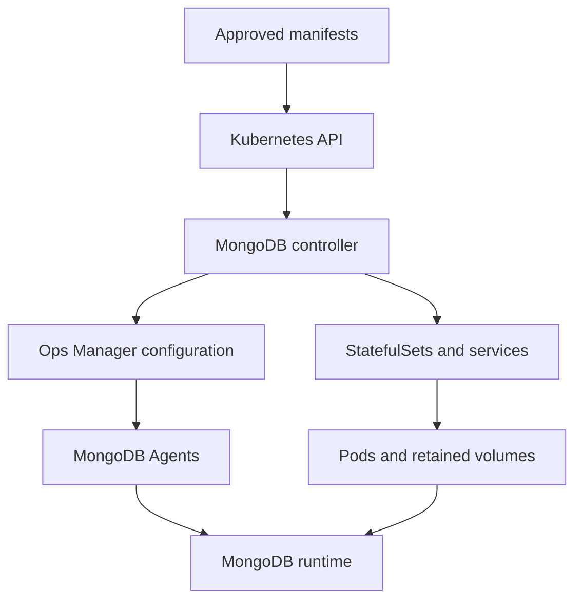

# 60 — Kubernetes Operator Compatibility and Deployment

Part 8 — Administration Deployment and Integration

**Baseline:** MongoDB Enterprise 8.0/FCV 8.0; an explicitly reviewed MongoDB Controllers for Kubernetes release, Kubernetes distribution, Ops Manager and Agent combination.  
**Status:** Written; static review complete; live operator installation and database deployment pending.  
**Prerequisites:** Chapters 25–32, 41–48, 57–59; authorized disposable Kubernetes cluster, working Ops Manager, kubectl, Helm, Python 3, OpenSSL, private PKI and supported persistent storage.

## 1. Define the deployment contract

Install a reviewed controller/CRD bundle, deploy a fresh authenticated TLS three-member Enterprise replica set, validate Kubernetes ownership and persistent storage, and verify the application through the database protocol. This chapter covers initial deployment. Chapter 61 covers storage, scheduling and maintenance in greater depth.

The lab uses a new namespace `mongodb-ch60`, resource `rs60lab`, one pre-created empty Ops Manager project, three persistent volumes and an internal client. It does not import existing databases, upgrade existing CRDs or install into the user's retained `mongodb` namespace. Cluster-scoped installation requires an explicitly authorized lab cluster because namespace isolation cannot isolate CRDs and cluster RBAC.

The current official controller family is MongoDB Controllers for Kubernetes, in `mongodb/mongodb-kubernetes`. Older Enterprise Operator manifests/charts and Community-specific resources are not interchangeable with this Enterprise `MongoDB` workflow. Select the supported release and migration path rather than combining snippets from different generations.

## 2. Separate the reconciliation authorities



The Kubernetes controller reconciles resources and integrates the Enterprise deployment with management automation. StatefulSets manage pod identity; CSI/storage infrastructure manages volume attachment; Agents and MongoDB handle management/runtime duties. Each layer has separate errors and acceptance checks.

Do not edit generated StatefulSets or automation configuration as an independent permanent source of truth. Reconciliation may overwrite those edits. Change the supported custom resource or documented management field according to the controller's ownership policy, then verify the resulting runtime.

| Layer | Desired state | Evidence of completion |
|---|---|---|
| Kubernetes API/CRDs | Correct served schemas and accepted objects | CRD establishment and server-side validation |
| Controller | Correct image, watch scope and RBAC | Healthy controller plus relevant reconciliation logs |
| Workload | Intended replicas, pod identities and mounted storage | Owned StatefulSet/pods/PVC/PV inventory |
| Management automation | Accepted process configuration | Ops Manager/Agent status at reviewed goal |
| Database/application | Healthy set, exact data and scoped credentials | Direct authenticated TLS probes |

## 3. Freeze the compatibility matrix

Record exact release/patch versions and artifact hashes before touching the cluster. Compatibility includes Kubernetes minor version/lifecycle, OS/architecture and container base images, not only the server version.

| Item | Required record | Review source |
|---|---|---|
| Controller | Release, image build/digest, repository commit | Release notes and compatibility page |
| Chart/manifests | Chart version/hash and rendered values | Matching tagged controller distribution |
| CRDs | Same supported release/schema bundle | Tagged CRDs and upgrade guidance |
| Kubernetes | Distribution and server minor/patch | Controller matrix and Kubernetes lifecycle |
| MongoDB | Exact 8.0 Enterprise patch and FCV | Supported server/image platform matrix |
| Ops Manager/Agent | Exact supported versions | Controller and Agent compatibility |
| Storage | CSI driver/version, StorageClass, filesystem | Platform/storage support and operational requirements |
| Security | Pod policy, UID/fsGroup, TLS/secret model | Selected controller security requirements |

Do not treat `current` docs as a pinned dependency. For example, an installation page can show a newly released controller before every compatibility table row is populated. An omitted combination is unresolved, not implicitly supported. Obtain explicit release documentation or support confirmation before proceeding.

The database `spec.version` convention can include an Enterprise suffix such as `8.0.<patch>-ent`. Use the format accepted by the selected controller and image mode. Do not copy `8.0.0` from an old example and assume it is the approved security patch. Likewise, select documented FCV behavior and verify actual FCV after deployment.

This lab keeps advanced preview/container modes and multi-cluster features disabled unless separately reviewed. A single-node development cluster can exercise manifests but cannot demonstrate node failure isolation.

## 4. Inventory the actual cluster and scope

Create a private workspace and use an explicit context on every Kubernetes operation. Do not change the default namespace/context globally.

```bash
umask 077
mkdir mongodb-ch60
cd mongodb-ch60
export LAB60_ROOT="$PWD"
mkdir input scripts private evidence pki
export RUN60="$(python3 -c 'import uuid; print(uuid.uuid4())')"
export NS60=mongodb-ch60
test -n "${KCTX60:?set the authorized disposable cluster context}"
printf '%s\n' "$RUN60" > evidence/run60.txt
kubectl --context "$KCTX60" version -o json > evidence/kubernetes60.json
kubectl --context "$KCTX60" get nodes -o wide > evidence/nodes60.txt
kubectl --context "$KCTX60" get storageclass -o yaml > evidence/storageclasses60.yaml
kubectl --context "$KCTX60" get crds -o name > evidence/preexisting-crds60.txt
kubectl --context "$KCTX60" get namespace "$NS60" --ignore-not-found
```

Require the namespace to be absent and inspect the cluster for existing MongoDB controllers/CRDs. This fresh-install path stops if relevant CRDs or another controller already exists. It supplies no in-place CRD upgrade procedure. Identify cluster UID/API endpoint, administrator and installation scope in the packet; a context label alone is not an independent cluster identity.

Review controller watch scope and cluster/namespaced RBAC. Namespace-only watching does not remove all cluster-scoped installation privileges. Check RoleBinding/ClusterRoleBinding subjects, service-account namespaces and permissions before installation.

## 5. Review persistent storage and scheduling prerequisites

Use an approved StorageClass with `Retain` reclaim policy for this exercise. Do not edit a shared production StorageClass to make it match. Review provisioner, volume binding mode, access mode, encryption, zone behavior, quotas and volume expansion support.

Plan enough schedulable capacity for the controller, three database/Agent pods and the client. Review generated container requests/limits and placement before accepting the deployment. Three pods on one node are three processes but one node failure domain.

This lab requests a single 16Gi volume per member for its tiny fixture. That is an exercise allocation, not a production sizing recommendation. Data, journal and log placement, retention, IOPS, throughput and rebuild space require workload sizing. Chapter 61 adds topology spreading, disruptions and storage operations.

Persistent storage is not a backup. A `Retain` PV can still become unavailable with its zone, storage account or underlying disk. Record separate backup objectives and recovery access. No backup is enabled by this chapter.

## 6. Install the matching controller and CRDs

Retrieve the approved tagged controller distribution and matching CRD bundle into `private/`. Verify artifact hashes and review all cluster-scoped resources. Choose either the supported manifest route or the supported Helm route, not both.

For the Helm route, set `CH60_CHART` to the verified local chart package. Create `input/operator-values60.yaml` from that release's documented values with its watched namespace set to `mongodb-ch60`, approved images/builds, resource requests and intended features. Values names differ between releases: retain the reviewed file rather than guessing a universal override flag.

```bash
test -f "${CH60_CHART:?set the approved local controller chart package}"
test -f private/crds60.yaml
test -f input/operator-values60.yaml
helm template ch60 "$CH60_CHART" --namespace "$NS60" \
  --values input/operator-values60.yaml > private/operator-rendered60.yaml
sha256sum "$CH60_CHART" private/crds60.yaml input/operator-values60.yaml \
  private/operator-rendered60.yaml > evidence/controller-artifacts60.sha256
```

Inspect the rendered Deployment, image/build, watch scope, namespaces, service accounts, RBAC and any admission/webhook resources. Confirm no unexpected external exposure or installation into another namespace. Review CRD conversion/admission implications and ensure matching supported schemas.

Create the owned namespace with a run label, then install the reviewed CRDs and controller through the selected release's documented procedure:

```bash
kubectl --context "$KCTX60" create namespace "$NS60"
kubectl --context "$KCTX60" label namespace "$NS60" chapter=60 run="$RUN60"
kubectl --context "$KCTX60" apply --dry-run=server -f private/crds60.yaml
kubectl --context "$KCTX60" create -f private/crds60.yaml
```

Wait for **every** CRD in the selected bundle to be Established before deploying resources. Record their names/UIDs and served/storage versions. Then install the verified local chart:

```bash
helm install ch60 "$CH60_CHART" --kube-context "$KCTX60" --namespace "$NS60" \
  --values input/operator-values60.yaml --wait --timeout 10m
kubectl --context "$KCTX60" -n "$NS60" get deployment,pods -o wide
```

Helm readiness does not prove database readiness. Verify the controller image actually running, current logs and namespace watch behavior. Helm's CRD install/upgrade semantics are separate from ordinary chart resources; never assume uninstall/rollback handles CRD lifecycle or data safely.

## 7. Bind a new Ops Manager project and credentials

Pre-create one empty dedicated Ops Manager project. Use a credential scoped to manage that already-created project according to the chosen release's required roles. Do not grant organization creation rights merely to work around an incorrect project name. Confirm the actual egress IP/CIDR of the controller is allowed by the API access policy.

Save `input/project60.yaml` from the release's supported ConfigMap workflow, using real organization/project values:

```yaml
apiVersion: v1
kind: ConfigMap
metadata:
  name: project60
  namespace: mongodb-ch60
data:
  projectName: REPLACE_WITH_EMPTY_LAB_PROJECT_NAME
  orgId: REPLACE_WITH_REAL_ORGANIZATION_ID
  baseUrl: https://ops60.example.invalid:8443
```

Replace every placeholder. Confirm this name resolves to the pre-created project in the intended organization before applying it; the controller can create a project when names do not match if the credential has sufficient rights.

Provision credentials through the approved secret manager or protected files. For the documented `publicKey`/`privateKey` Secret format, avoid literal secret values in process arguments:

```bash
test -s private/ops-publicKey60.txt
test -s private/ops-privateKey60.txt
kubectl --context "$KCTX60" -n "$NS60" create secret generic ops-credentials60 \
  --from-file=publicKey=private/ops-publicKey60.txt \
  --from-file=privateKey=private/ops-privateKey60.txt
kubectl --context "$KCTX60" -n "$NS60" create -f input/project60.yaml
```

Write key files through the approved secret retrieval path without trailing unwanted newlines; never display their contents. Kubernetes Secret base64 encoding is not encryption. Review at-rest encryption, RBAC, secret access and API credential rotation separately.

For private management CAs, configure the selected release's documented management trust mechanism in both controller and Agents. The database CA ConfigMap in the next section is not automatically the trust configuration for the Ops Manager HTTPS endpoint. Verify actual pod-to-management TLS/API access with its intended identities.

## 8. Provision database and Agent certificates

Use the selected release's TLS procedure and the **actual** pod/service DNS names generated by its resource naming rules. Internal DNS suffixes can differ from `cluster.local`. Build SANs from that confirmed naming contract; do not issue certificates from a guessed old StatefulSet/service pattern.

Prepare a database certificate/key covering all three advertised member names, an Agent certificate/key with the documented identity separation, and a CA certificate. Validate key/certificate match, SANs, EKUs, validity and chain before uploading. Member/Agent identity and internal authentication rules must follow the selected SCRAM/TLS workflow; this lab does not silently switch to X.509 user or internal-cluster authentication.

For resource `rs60lab` and prefix `ch60`, the documented TLS-secret naming pattern is `ch60-rs60lab-cert` and `ch60-rs60lab-agent-certs`. Confirm that pattern for the pinned release. Use `kubernetes.io/tls` Secrets rather than an old concatenated Opaque-secret example.

```bash
kubectl --context "$KCTX60" -n "$NS60" create secret tls ch60-rs60lab-cert \
  --cert=pki/database60.crt --key=pki/database60.key
kubectl --context "$KCTX60" -n "$NS60" create secret tls ch60-rs60lab-agent-certs \
  --cert=pki/agent60.crt --key=pki/agent60.key
kubectl --context "$KCTX60" -n "$NS60" create configmap database-ca60 \
  --from-file=ca-pem=pki/ca60.pem
```

The certificate files are real reviewed prerequisites, not files generated by this command block. Keep CA signing keys outside Kubernetes workload secrets. Do not fix DNS/SAN failures with invalid-hostname or invalid-certificate client flags.

## 9. Prepare the Enterprise replica-set resource

Save `input/database60.yaml` using the pinned CRD schema. The following scaffold shows the intended baseline. Replace `REPLACE_WITH_APPROVED_8_0_PATCH-ent`, storage class and run label; add reviewed release-supported resource/scheduling settings before server-side validation and deployment.

```yaml
apiVersion: mongodb.com/v1
kind: MongoDB
metadata:
  name: rs60lab
  namespace: mongodb-ch60
  labels:
    chapter: "60"
    run: REPLACE_WITH_RUN60
spec:
  type: ReplicaSet
  members: 3
  version: REPLACE_WITH_APPROVED_8_0_PATCH-ent
  persistent: true
  opsManager:
    configMapRef:
      name: project60
  credentials: ops-credentials60
  security:
    authentication:
      enabled: true
      modes: [SCRAM]
    tls:
      ca: database-ca60
    certsSecretPrefix: ch60
  podSpec:
    persistence:
      single:
        storage: 16Gi
        storageClass: REPLACE_WITH_RETAIN_STORAGECLASS
```

No external access is enabled. Client connections run inside the cluster or through a reviewed network path that supports every advertised member name. A single pod port-forward is not a transparent replica-set endpoint for discovery.

Check that the actual controller/image path supports the specified Enterprise version format and intended authentication. Apply no schema overrides copied from Community resources (`MongoDBCommunity`) or Atlas resources. The scaffold alone does not claim tested compatibility with every controller release.

## 10. Validate and submit the intended generation

Use a local YAML parser that rejects duplicate keys, review all fields, and perform strict server-side dry-run against the installed CRD. This can validate schema/admission behavior but does not exercise future controller calls, image pulls, certificates or CSI provisioning.

```bash
kubectl --context "$KCTX60" -n "$NS60" apply --dry-run=server --validate=strict \
  -f input/database60.yaml -o yaml > private/admitted-dry-run60.yaml
kubectl --context "$KCTX60" -n "$NS60" create -f input/database60.yaml
kubectl --context "$KCTX60" -n "$NS60" get mongodb rs60lab -o json \
  > evidence/database-created60.json
```

Record the accepted object UID and generation immediately. Confirm the admitted spec retains the intended fields and references. Unknown fields can be rejected or pruned according to CRD behavior; a silently absent security/storage field is not accepted merely because creation succeeded.

Review status and events at bounded intervals. Use the readiness/status fields documented by the pinned release; do not invent a universal `Ready` condition or `observedGeneration` field. Preserve failure states and controller logs if reconciliation stops. An accepted object is not yet a database deployment.

## 11. Collect Kubernetes ownership and storage evidence

In this fresh namespace, identify the database StatefulSet and the three member pods. Record owner-reference chains from the MongoDB UID through generated workloads. Do not use names or Ready counts alone to attribute pods to a resource.

```bash
kubectl --context "$KCTX60" -n "$NS60" get mongodb rs60lab -o json > evidence/database60.json
kubectl --context "$KCTX60" -n "$NS60" get statefulsets -o json > evidence/statefulsets60.json
kubectl --context "$KCTX60" -n "$NS60" get pods -o json > evidence/pods60.json
kubectl --context "$KCTX60" -n "$NS60" get pvc -o json > evidence/pvcs60.json
kubectl --context "$KCTX60" get pv -o json > private/pvs60.json
kubectl --context "$KCTX60" -n "$NS60" get services -o wide > evidence/services60.txt
kubectl --context "$KCTX60" -n "$NS60" get events --sort-by=.metadata.creationTimestamp \
  > private/events60.txt
```

Full PV inventory can reveal other infrastructure. Keep it private and share only the reviewed lab subset. Sequential API snapshots are not atomic: if reconciliation changes objects during capture, recollect a consistent stable packet before accepting.

Verify each member has its own bound persistent claim/volume, expected storage class/capacity, correct mount, matching PV claimRef UID and retained reclaim policy. Readiness should include every intended workload container, with no terminating pod. Inspect actual requests/limits, node placement, generated services, image digests and current revisions.

The controller pod is not a database member. A controller/other pod in the same namespace must not inflate the three-member Ready count.

## 12. Implement the recorded workload gate

Save `scripts/workload60.py`. It checks the common single-StatefulSet/single-volume-per-member layout of this lab. If the selected release generates a different ownership/layout, stop and develop a reviewed adapter rather than bypassing checks. It is an offline evidence evaluator, not a cluster query.

```python
import hashlib
import json
import pathlib
import sys

def require(ok, message):
    if not ok:
        raise ValueError(message)

def owned(obj, parent_uid):
    return any(ref.get('uid') == parent_uid and ref.get('controller') is True
               for ref in obj['metadata'].get('ownerReferences', []))

def evaluate(database, statefulsets, pods, pvcs, pvs, run_id, expected_uid, generation):
    meta, spec = database['metadata'], database['spec']
    require(meta['name'] == 'rs60lab' and meta['namespace'] == 'mongodb-ch60' and
            meta['uid'] == expected_uid and type(meta['generation']) is int and
            meta['generation'] == generation and not meta.get('deletionTimestamp'), 'wrong CR identity')
    require(meta['labels']['run'] == run_id and meta['labels']['chapter'] == '60', 'ownership labels differ')
    require(type(spec['members']) is int and spec['members'] == 3 and
            spec['type'] == 'ReplicaSet' and spec['persistent'] is True, 'wrong deployment scope')
    require(spec['security']['authentication']['enabled'] is True and
            spec['security']['authentication']['modes'] == ['SCRAM'] and
            spec['security']['tls']['ca'] == 'database-ca60' and
            spec['security']['certsSecretPrefix'] == 'ch60', 'security spec differs')
    sets = [obj for obj in statefulsets['items'] if owned(obj, expected_uid)]
    require(len(sets) == 1, 'one directly owned database StatefulSet required')
    sts = sets[0]
    require(sts['metadata']['namespace'] == 'mongodb-ch60' and
            not sts['metadata'].get('deletionTimestamp'), 'wrong/deleting StatefulSet')
    status = sts['status']
    require(sts['spec']['replicas'] == 3 and status.get('readyReplicas') == 3 and
            status.get('updatedReplicas') == 3 and
            status['observedGeneration'] == sts['metadata']['generation'] and
            status['currentRevision'] == status['updateRevision'], 'StatefulSet not reconciled')
    members = [obj for obj in pods['items'] if owned(obj, sts['metadata']['uid'])]
    require(len(members) == 3 and len({p['metadata']['uid'] for p in members}) == 3,
            'exactly three owned member pods required')
    claims = set()
    for pod in members:
        require(pod['metadata']['namespace'] == 'mongodb-ch60' and
                not pod['metadata'].get('deletionTimestamp') and
                pod['status']['phase'] == 'Running', 'wrong/deleting/nonrunning pod')
        require(any(c.get('type') == 'Ready' and c.get('status') == 'True'
                    for c in pod['status'].get('conditions', [])), 'pod not Ready')
        declared = {c['name'] for c in pod['spec']['containers']}
        observed = pod['status'].get('containerStatuses', [])
        require(declared and len(observed) == len(declared) and
                {c['name'] for c in observed} == declared and
                all(c.get('ready') is True and 'running' in c.get('state', {}) for c in observed),
                'container status incomplete')
        mounted = [v['persistentVolumeClaim']['claimName'] for v in pod['spec'].get('volumes', [])
                   if 'persistentVolumeClaim' in v]
        require(len(mounted) == 1 and mounted[0] not in claims, 'one distinct claim per member required')
        claims.add(mounted[0])
    claim_rows = [c for c in pvcs['items'] if c['metadata']['name'] in claims and
                  c['metadata']['namespace'] == 'mongodb-ch60']
    require(len(claim_rows) == 3 and len({c['metadata']['name'] for c in claim_rows}) == 3,
            'missing/duplicate claims')
    storage_class = spec['podSpec']['persistence']['single']['storageClass']
    require(isinstance(storage_class, str) and storage_class and 'REPLACE' not in storage_class,
            'real storage class required')
    volume_names = set()
    for claim in claim_rows:
        require(not claim['metadata'].get('deletionTimestamp') and
                claim['status']['phase'] == 'Bound' and
                claim['spec']['storageClassName'] == storage_class, 'claim not accepted')
        volume_name = claim['spec']['volumeName']
        require(volume_name not in volume_names, 'members share a PV')
        volume_names.add(volume_name)
        matches = [v for v in pvs['items'] if v['metadata']['name'] == volume_name]
        require(len(matches) == 1, 'PV missing or duplicate')
        pv = matches[0]
        ref = pv['spec']['claimRef']
        require(not pv['metadata'].get('deletionTimestamp') and pv['status']['phase'] == 'Bound' and
                pv['spec']['persistentVolumeReclaimPolicy'] == 'Retain' and
                ref['uid'] == claim['metadata']['uid'] and ref['name'] == claim['metadata']['name'] and
                ref['namespace'] == 'mongodb-ch60', 'PV identity/retention mismatch')
    return {'claim': 'recorded_owned_kubernetes_workload_ready', 'runId': run_id,
            'mongodbUid': expected_uid, 'generation': generation,
            'memberPods': sorted(p['metadata']['name'] for p in members),
            'pvcNames': sorted(claims), 'pvNames': sorted(volume_names),
            'databaseAcceptanceProven': False}

if __name__ == '__main__':
    try:
        require(len(sys.argv) == 10,
                'usage: workload60.py CR STS PODS PVC PV RUN UID GENERATION NEW_REPORT')
        blobs = [pathlib.Path(p).read_bytes() for p in sys.argv[1:6]]
        require(sys.argv[6].strip() and 'REPLACE' not in sys.argv[6], 'real run ID required')
        require(sys.argv[7].strip(), 'recorded CR UID required')
        report = evaluate(*(json.loads(b) for b in blobs), sys.argv[6], sys.argv[7], int(sys.argv[8]))
        report['inputSha256'] = [hashlib.sha256(b).hexdigest() for b in blobs]
        with open(sys.argv[9], 'x', encoding='utf-8') as out:
            json.dump(report, out, indent=2)
            out.write('\n')
    except (ValueError, TypeError, KeyError, OSError) as error:
        print('REJECTED: ' + str(error), file=sys.stderr)
        sys.exit(1)
```

Run against the captured packet using the UID/generation recorded after creation:

```bash
test -n "${CR60_UID:?set the recorded created MongoDB UID}"
test -n "${CR60_GENERATION:?set its recorded accepted generation}"
python3 scripts/workload60.py evidence/database60.json evidence/statefulsets60.json \
  evidence/pods60.json evidence/pvcs60.json private/pvs60.json \
  "$RUN60" "$CR60_UID" "$CR60_GENERATION" evidence/workload-accepted60.json
```

The gate does not prove CSI encryption, effective capacity, mount contents, topology spread, database version/FCV, CR status convergence or backup. Review those separately. Recorded hashes bind the report to supplied bytes; they do not sign the API observations or establish freshness. Retain capture timestamps and verify the live stable state close to acceptance.

## 13. Provision users and verify through MongoDB

Create a separate scoped database user through the pinned release's supported `MongoDBUser` workflow. The following example grants only application read/write access; provide a protected password Secret named `app-password60` with key `password` through the approved secret path.

```yaml
apiVersion: mongodb.com/v1
kind: MongoDBUser
metadata:
  name: app60
  namespace: mongodb-ch60
spec:
  username: app60
  db: admin
  passwordSecretKeyRef:
    name: app-password60
    key: password
  mongodbResourceRef:
    name: rs60lab
  roles:
    - db: mongodb_enterprise_tutorial_ch60
      name: readWrite
```

Validate/create this user resource against the pinned schema and wait for its documented success state. Provision a separate approved diagnostic user through the same managed workflow for topology/version checks. Do not extract or reuse automation credentials as the application identity.

Use a reviewed pinned client inside the cluster with CA trust and the actual replica-set connection string. The client must resolve/reach every advertised member FQDN and preserve hostname verification. Supply the password by interactive prompt or protected runtime mechanism, not a URI committed to this tutorial.

On the diagnostic connection, require server Enterprise 8.0, FCV 8.0, correct replica-set identity and exactly the intended three voting data-bearing members with one primary/two healthy secondaries. Compare member addresses with Kubernetes/Ops Manager evidence. Check recent Agent contact and automation convergence as in Chapter 58.

On the scoped application connection, save/run this fixture once with `ACTION60=initialize`, then with `ACTION60=verify`. Set `RUN60` and `SET60_NAME` in the client environment to the real run and discovered expected set name; do not guess that the CR name always equals runtime set identity.

```javascript
const run60 = process.env.RUN60;
const expectedSet60 = process.env.SET60_NAME;
const action60 = process.env.ACTION60;
const a60 = db.getSiblingDB('admin');
const d60 = db.getSiblingDB('mongodb_enterprise_tutorial_ch60');
function check60(ok, message) { if (!ok) throw new Error(message); }
const hello60 = a60.runCommand({hello: 1});
check60(run60 && expectedSet60 && hello60.setName === expectedSet60 &&
  hello60.isWritablePrimary === true, 'wrong owned primary');
if (action60 === 'initialize') {
  check60(d60.getCollectionInfos().length === 0, 'database not empty');
  d60.orders.createIndex({code: 1}, {unique: true, name: 'code_unique60'});
  d60.orders.insertMany(Array.from({length: 50}, (_, n) =>
    ({_id: n + 1, code: `order-${n + 1}`, amountCents: (n + 1) * 10})),
    {writeConcern: {w: 'majority', j: true, wtimeout: 30000}});
  d60.markers.insertOne({_id: 'owner', runId: run60, chapter: 60},
    {writeConcern: {w: 'majority', j: true, wtimeout: 30000}});
} else check60(action60 === 'verify', 'initialize or verify required');
const owner60 = d60.markers.findOne({_id: 'owner'});
check60(owner60 && owner60.runId === run60 && owner60.chapter === 60, 'owner mismatch');
const rows60 = d60.orders.find().sort({_id: 1}).toArray();
check60(rows60.length === 50, 'wrong count');
rows60.forEach((row, n) => check60(row._id === n + 1 && row.code === `order-${n + 1}` &&
  row.amountCents === (n + 1) * 10 && Object.keys(row).length === 3, 'document mismatch'));
check60(rows60.reduce((sum, row) => sum + row.amountCents, 0) === 12750, 'wrong sum');
let denied60 = false;
try {
  const response60 = a60.runCommand({getParameter: 1, featureCompatibilityVersion: 1});
  if (response60.code === 13) denied60 = true;
  else if (response60.ok !== 1) throw new Error('unexpected diagnostic failure');
} catch (error) { if (error.code !== 13) throw error; denied60 = true; }
check60(denied60, 'application unexpectedly has administrative access');
printjson({runId: run60, count: 50, amountCents: 12750, adminDenied: true});
```

Record both direct secondary majority reads with the diagnostic identity and expected owner/data state. The application probe proves its scoped write/read and administrative rejection, not full production application behavior. Retain certificate failures and permission denials accurately rather than counting any connection error as an authorization pass.

## 14. Troubleshoot reconciliation by layer

| Symptom | First evidence | Resolution boundary |
|---|---|---|
| No matching API kind | Installed CRDs/served versions | Matching supported CRD bundle; not random manifest edits |
| CR accepted, no workload | Controller scope/RBAC/logs and management credential | Resolve controller access/identity |
| ImagePullBackOff | Image name/digest, architecture, registry policy | Approved supported artifacts and pull access |
| Pending PVC/pod | StorageClass, CSI events, quota and topology | Provisioning/scheduling; do not delete data claims |
| Pod starts, Agent cannot contact management | Pod egress, DNS, management CA and API policy | Management connectivity/identity |
| TLS handshake fails | Actual advertised DNS names, secret types, SAN/CA | Correct issued trust material |
| Ready pods but no healthy majority | MongoDB status/logs and effective configuration | Database/member health, not another Ready-count check |
| Operator repeatedly undoes manual edits | Field ownership and CR/automation inputs | Restore a single approved reconciliation authority |
| Delete is stuck | Finalizers, controller state and retained resource dependencies | Supported cleanup; no blind finalizer removal |

Capture bounded controller/Agent/database logs privately. Inspect container names before `kubectl logs`; the Agent and database may be distinct containers. Avoid dumping Secrets or secret-bearing automation configuration into a public incident note.

## 15. Plan controller upgrades and production acceptance

Controller, CRD, Kubernetes, Agent, Ops Manager, database binary and FCV upgrades are separate change dimensions. Plan compatible intermediate versions, CRD schema/storage changes and rollback limits before any upgrade. A Helm rollback is not a database downgrade and does not undo an FCV transition.

Production acceptance adds resource requests/limits, node/zone placement, disruption budgets, effective network policy, KMS/secrets rotation, independent backups, restore drills, monitoring/alerts and application failure behavior. Verify the effective generated workload and live behavior; accepted YAML is only the starting point.

For an existing legacy Enterprise Operator deployment, use the official migration procedure for the exact releases. Do not install the replacement controller alongside it with overlapping watch scope or apply new CRDs over old resources without a supported migration plan. Preserve the old control-plane/data evidence and manage authority transition explicitly.

## 16. Acceptance, offline tests and guarded cleanup

Test the workload evaluator with a clearly labeled synthetic packet. Require a valid three-member ownership/storage packet to pass. Require rejection for wrong UID/generation/run, disabled authentication, foreign owner references, stale StatefulSet revision, missing/unready/deleting pods, shared claims/PVs, unbound claims, wrong storage class, `Delete` reclaim policy and mismatched PV claim UID.

Also parse every YAML example with duplicate-key rejection and check Bash/JS/Python syntax. Server-side dry-run and live controller/CSI/database behavior remain separate runtime checks. No synthetic packet or local evaluator result increases the series' runtime validation count.

Deliver the compatibility review, tagged artifacts/hashes, cluster/namespace/project identities, admitted resource generation, workload/PVC/PV inventory, images/requests/placement, management convergence and direct TLS/application results. Record pending checks and failed attempts. Keep credentials and full sensitive inventories private.

For cleanup, inspect namespace run label, CR UID, generated ownership, finalizers and retention behavior before any delete. Stop workload/application activity through the selected release's supported workflow and preserve backup/data evidence. Deleting a namespace can delete claims and secrets; `Retain` protects the PV's reclaim behavior but is not a complete recovery procedure.

Do not remove shared CRDs, ClusterRoles or controllers as part of namespace cleanup. Do not force-delete pods, remove finalizers or delete PVCs to get a quick green result. On this dedicated cluster, controller/cluster-scoped removal still requires inventory of the exact installed resources and confirmation no other custom resources depend on them.

The default handoff leaves the accepted lab resources retained for Chapter 61. Record ongoing capacity/cost and ownership. If the lab must be retired, use the reviewed release-specific deletion process after retention is decided, not an unqualified `delete namespace` command.

## 17. References and next chapter

Use the selected release's versioned documentation and tagged artifacts; `current` changes over time.

- [Controllers for Kubernetes repository](https://github.com/mongodb/mongodb-kubernetes)
- [Controller compatibility](https://www.mongodb.com/docs/kubernetes/current/tutorial/plan-k8s-op-compatibility/)
- [Controller installation](https://www.mongodb.com/docs/kubernetes/current/tutorial/install-k8s-operator/)
- [Deploy a replica set with TLS](https://www.mongodb.com/docs/kubernetes/current/tutorial/deploy-replica-set/)
- [MongoDB resource specification](https://www.mongodb.com/docs/kubernetes/current/reference/k8s-operator-specification/)
- [Operator API credentials](https://www.mongodb.com/docs/kubernetes/current/tutorial/create-operator-credentials/)
- [Project ConfigMap](https://www.mongodb.com/docs/kubernetes/current/tutorial/create-project-using-configmap/)
- [Manage SCRAM database users](https://www.mongodb.com/docs/kubernetes/current/tutorial/manage-database-users-scram/)
- [Chapter 59 — Linux Installation Configuration and Service Operations](59-linux-installation-configuration-and-service-operations.md)

Next: **Chapter 61 — Kubernetes Storage Scheduling and Maintenance** (planned).
